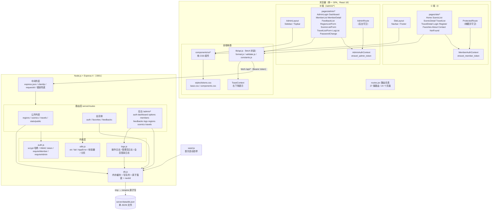
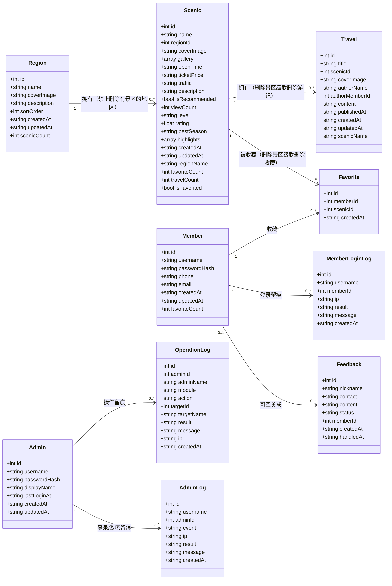
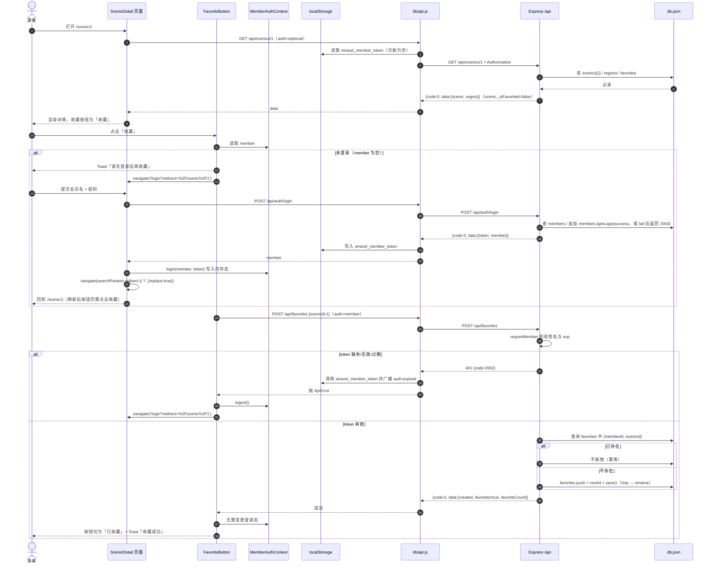
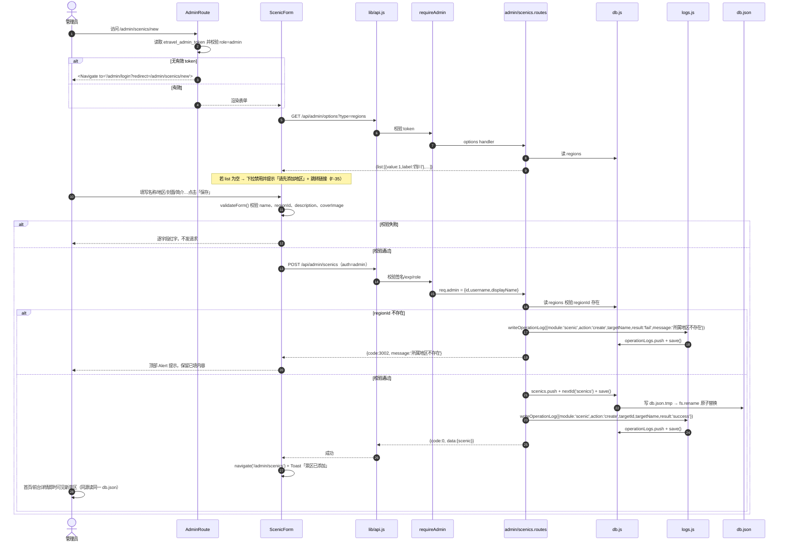

# e起去旅行 — 系统设计文档

| 项目信息 | 内容 |
| --- | --- |
| 站点中文名 | **e起去旅行** |
| Slogan | 「e 键出发，风景在前」 |
| 项目代号 | `e-travel` |
| 文档版本 | v1.0 |
| 撰写人 | 高见远（架构师） |
| 上游文档 | `docs/PRD.md` v1.0（产品经理 许清楚）+ 《软件用户业务流程》《软件管理员业务流程》《软件设计前端》《软件设计后端》 |
| 文档定位 | 可直接指导工程师逐条实现的技术设计书，**不含实现代码**（JSON 样例 / 表格 / 函数签名 / Mermaid 除外） |

---

## 0. 设计前提（已定型约束，不再讨论）

| 编号 | 约束 | 落地方式 |
| --- | --- | --- |
| A-01 | 技术栈 | Vite 5 + React 18 + react-router-dom 6；**纯手写 CSS**（CSS 变量设计系统），**JS + JSX，不用 TypeScript**，不引入任何 UI 组件库 |
| A-02 | 后端 | Node.js + Express 4，ESM（`"type": "module"`）；持久化 = 单个 JSON 文件 `server/data/db.json`，**原子写入**（写 `.tmp` → `fs.rename`），进程内写队列串行化 |
| A-03 | 认证 | 两套独立账号体系。密码 `crypto.scrypt` 加盐哈希；登录签发**无状态签名 token** = `base64url(payload).base64url(hmacSHA256(签名密钥, base64url(payload)))`，payload = `{ sub, role, exp }`，7 天有效；服务端只验签名与过期，**重启不掉线** |
| A-04 | 前端存储 | `localStorage.etravel_member_token` / `localStorage.etravel_admin_token`，两套登录态互不可见 |
| A-05 | 单 SPA | C 端路由在 `/`，后台在 `/admin/*`；两套 Layout、两套 Context、两套守卫 |
| A-06 | 单命令启动 | 根目录单一 `package.json`；`npm run dev` → `node scripts/dev.mjs` → spawn API(:3001) + `createServer()` 起 Vite(:5173)；Vite `server.proxy` 把 `/api` 转发到 3001 |
| A-07 | 依赖极简 | runtime：`express`（+ 三个前端包）；dev：`vite`、`@vitejs/plugin-react`。**不用 axios / dayjs / concurrently / multer / jsonwebtoken / bcrypt** |
| A-08 | 图片素材 | 仅 9 个真实文件：`/images/jiuzhaigou.png`、`zhangjiajie.png`、`westlake.png`、`potala.png`、`huangshan.png`、`sanya.png`、`guilin.png`、`lijiang.png`、`about.png`。**不新增、不引用不存在的图片**；头像用 CSS 渐变 + 首字母 |
| A-09 | 种子数据 | 8 地区 / 8 景区（与 8 张景区图 1:1 独占）/ 8 游记（封面复用所属景区图）；地区卡片与游记封面全部复用景区图 |
| A-10 | 范围 | P0 46 条全做；P1 只做 F-50/F-52/F-54（骨架屏、图片路径预览、404 页），其余 P1/P2 不做 |

---

## 1. 架构总览

### 1.1 运行形态

| 场景 | 端口 | 数据流 |
| --- | --- | --- |
| 开发 `npm run dev` | Vite :5173 / API :3001 | 浏览器 :5173 → 静态资源由 Vite 直出 → `/api/*` 经 Vite proxy 转发到 :3001 → Express → `db.json` |
| 生产 `npm run build && npm start` | 单端口 :3001 | 浏览器 :3001 → `express.static(dist)` 出静态资源 → `/api/*` 同进程 Express → `db.json`；非 `/api` 的 GET 全部回落 `dist/index.html`（SPA 路由交给前端） |

### 1.2 分层架构图



**分层职责边界**

| 层 | 职责 | 禁止 |
| --- | --- | --- |
| `pages/*` | 页面编排：取数、筛选、表单状态、跳转 | 不直接写 `fetch`，不写业务校验字符串（用 `lib/validate.js`） |
| `components/*` | 纯展示 + 受控交互，通过 props 回调 | 不发请求（`FavoriteButton` 允许发起收藏请求，属唯一例外） |
| `lib/api.js` | 唯一 HTTP 出口：拼 URL、注入 token、统一错包、401 处理 | 不含业务语义 |
| `context/*` | 全局登录态与 Toast | 不承载列表数据 |
| `routes/*` | 参数校验 → 业务规则 → 读写 db → 写日志 → 统一响应 | 不写 HTML、不抛裸字符串 |
| `db.js` | 唯一读写入口、唯一 ID 分配器 | 业务代码禁止 `fs` 直接读写 `db.json` |

### 1.3 目录树（到文件级，含职责与行数量级）

```
e-travel/
├── package.json                        # 30   单一工程：type=module、scripts(dev/build/start)、依赖声明
├── .gitignore                          # 8    node_modules / dist / server/data/db.json
├── README.md                           # 60   启动说明、默认账号、端口、目录导览
├── docs/
│   ├── PRD.md
│   └── DESIGN.md                       # 本文档
├── scripts/
│   └── dev.mjs                         # 70   spawn API 进程 + createServer() 起 Vite；SIGINT 双进程退出
├── server/
│   ├── index.js                        # 90   Express 装配：json、requestId、路由挂载、错误兜底、生产 static + SPA 回落、启动自举
│   ├── constants.js                    # 40   枚举：日志模块/动作/结果、token TTL、分页上限、日志保留条数
│   ├── utils.js                        # 170  ok/fail、AppError、asyncHandler、parsePaging、校验器、clientIp、nowIso
│   ├── db.js                           # 200  读取缓存、原子写(队列)、nextId、bootstrap(缺失则 seed)
│   ├── seed.js                         # 380  8 地区/8 景区/8 游记/2 会员/1 管理员/收藏/反馈/示例日志
│   ├── auth.js                         # 150  hashPassword/verifyPassword、signToken/verifyToken、requireMember/requireAdmin/optionalMember
│   ├── logs.js                         # 90   writeOperationLog / writeAdminLog / writeMemberLoginLog（含上限裁剪）
│   ├── data/
│   │   └── db.json                     # 运行时生成（不入库）
│   └── routes/
│       ├── index.js                    # 40   总路由聚合：/api 公开 + 会员侧，/api/admin 后台
│       ├── auth.routes.js              # 130  注册/登录/me/退出（F-01~F-04、F-45）
│       ├── favorites.routes.js         # 90   收藏列表/新增(幂等)/取消（F-11、F-12、F-16）
│       ├── feedbacks.routes.js         # 60   意见反馈提交（F-19）
│       ├── regions.routes.js           # 60   地区列表/详情（F-06）
│       ├── scenics.routes.js           # 150  景区列表(筛选/排序/分页/推荐)/详情/关联游记（F-05、F-09、F-10、F-13、F-47）
│       ├── travels.routes.js           # 80   游记列表/详情（F-14、F-15）
│       ├── stats.routes.js             # 40   公开统计（F-17）
│       └── admin/
│           ├── auth.routes.js          # 120  管理员登录/退出/me/改密（F-20、F-22、F-23、F-44）
│           ├── dashboard.routes.js     # 70   仪表盘统计 + 最近操作日志（F-25）
│           ├── options.routes.js       # 50   下拉选项（地区/景区/会员精简列表）
│           ├── members.routes.js       # 90   会员列表/详情（F-26、F-27）
│           ├── feedbacks.routes.js     # 80   意见建议列表/标记状态（F-28、F-29）
│           ├── logs.routes.js          # 110  三类日志分页筛选（F-43~F-46）
│           ├── regions.routes.js       # 150  地区 CRUD + 占用校验 + 操作日志（F-30~F-33、F-43）
│           ├── scenics.routes.js       # 200  景区 CRUD + 推荐开关 + 级联删除（F-34~F-38、F-43）
│           └── travels.routes.js       # 150  游记 CRUD + 操作日志（F-39~F-42、F-43）
└── frontend/
    ├── index.html                      # 20   SPA 挂载点、lang=zh-CN、viewport、主题色
    ├── vite.config.js                  # 30   root/publicDir/proxy/outDir/emptyOutDir
    ├── public/
    │   └── images/                     # 9 张 png（已就绪，勿动）
    └── src/
        ├── main.jsx                     # 30   createRoot + 三层 Provider + BrowserRouter
        ├── App.jsx                      # 40   Layout 分流（C 端/B 端/独立）+ 全局 Toast 容器
        ├── routes.jsx                   # 150  27 条路由总表（懒加载可省，直接静态 import）
        ├── styles/
        │   ├── tokens.css               # 90   CSS 变量：色板/字号/间距/圆角/阴影/断点/层级
        │   ├── base.css                 # 160  reset、排版、容器、栅格、链接、滚动条
        │   └── components.css           # 520  全部组件的类名样式（8 类组件全部变体）
        ├── lib/
        │   ├── api.js                   # 170  request() 封装、token 管理、ApiError、401 清态
        │   ├── format.js                # 70   formatDate/formatDateTime/fromNow/truncate/initialOf
        │   ├── validate.js              # 90   手机号/邮箱/必填/长度/密码/validateForm
        │   └── constants.js             # 60   导航项、页面尺寸、状态文案映射、图片路径常量
        ├── context/
        │   ├── MemberAuthContext.jsx    # 100  会员登录态：member/token/login/register/logout/refresh
        │   ├── AdminAuthContext.jsx     # 90   管理员登录态
        │   └── ToastContext.jsx         # 80   showToast(msg, type)
        ├── components/
        │   ├── ui/
        │   │   ├── Button.jsx           # 40   variant: primary/ghost/danger/text；size；loading
        │   │   ├── Input.jsx            # 45   + 密码显隐、前后缀
        │   │   ├── Textarea.jsx         # 40   + 字数计数
        │   │   ├── Select.jsx           # 40   原生 select 包装 + 空选项
        │   │   ├── FormField.jsx        # 35   label + 必填星 + 错误文案插槽
        │   │   ├── Card.jsx             # 30   Card / CardMedia / CardBody
        │   │   ├── Tag.jsx              # 30   region/recommend/pending/resolved/level
        │   │   ├── Spinner.jsx          # 30   居中加载 + 行内加载
        │   │   ├── Skeleton.jsx         # 50   P1：卡片/列表/详情三种骨架
        │   │   ├── EmptyState.jsx       # 40   插图 + 说明 + 主操作按钮
        │   │   ├── Modal.jsx            # 70   遮罩/esc 关闭/焦点、ConfirmDialog 复用
        │   │   ├── Toast.jsx            # 50   右下角提示队列渲染
        │   │   ├── Pagination.jsx       # 60   上/下页 + 页码 + 总数
        │   │   ├── DataTable.jsx        # 90   后台表格：列配置、空态行、loading 行
        │   │   ├── ImagePathInput.jsx   # 70   路径输入 + 16:9 实时预览（F-52）
        │   │   └── GalleryPathInput.jsx # 60   多行路径 + 标签式增删 + 缩略图
        │   ├── site/
        │   │   ├── SiteLayout.jsx       # 60   Navbar + <Outlet/> + Footer（贴底布局）
        │   │   ├── Navbar.jsx           # 130  导航高亮、搜索框、会员菜单、移动端抽屉
        │   │   ├── Footer.jsx           # 50   站点名/slogan/快捷链接/版权
        │   │   ├── AuthLayout.jsx       # 50   左图右表单（窄屏隐藏图区）
        │   │   ├── ProtectedRoute.jsx   # 40   会员守卫 → /login?redirect=
        │   │   ├── HeroSearch.jsx       # 60   首屏横幅 + slogan + 搜索框（背景用 about.png 或九寨沟图）
        │   │   ├── SectionHeader.jsx    # 30   区块标题 + 右侧「查看全部 →」
        │   │   ├── ScenicCard.jsx       # 70   16:9 封面、名称、地区标签、摘要、可选取消收藏角标
        │   │   ├── RegionCard.jsx       # 45   封面 + 地区名 + N 个景区
        │   │   ├── TravelCard.jsx       # 55   封面 + 标题 + 景区标签 + 作者 + 日期
        │   │   ├── FilterSidebar.jsx    # 70   地区单选列表 + 清空筛选
        │   │   ├── FavoriteButton.jsx   # 80   收藏/已收藏 切换、未登录拦截、Toast
        │   │   ├── ImageGallery.jsx     # 60   1 主 2 副图（移动端横滑）
        │   │   ├── InfoBar.jsx          # 45   开放时间/门票/交通/最佳季节 四列
        │   │   ├── ArticleBody.jsx      # 35   正文按 \n\n 分段渲染
        │   │   └── ScenicCalloutCard.jsx# 45   游记底部所属景区引导卡
        │   └── admin/
        │       ├── AdminLayout.jsx      # 70   Sidebar + Topbar + <Outlet/>
        │       ├── AdminSidebar.jsx     # 90   7 项菜单 + 高亮 + 窄屏折叠
        │       ├── AdminTopbar.jsx      # 60   站点名/当前管理员/退出
        │       ├── AdminRoute.jsx       # 40   管理员守卫 → /admin/login?redirect=
        │       ├── StatCard.jsx         # 45   数字 + 标签 + 可点击跳转
        │       ├── RecentLogList.jsx    # 45   最近 8 条操作日志
        │       ├── FilterBar.jsx        # 60   工具条：搜索/下拉/重置
        │       ├── FormShell.jsx        # 60   面包屑 + 表单卡 + 底部操作条
        │       ├── RecommendSwitch.jsx  # 55   推荐开关（失败回滚）
        │       └── StatusChip.jsx       # 30   pending/resolved 标签
        └── pages/
            ├── site/
            │   ├── Home.jsx             # 180  推荐景区(6)/推荐地区(6)/最新游记(3)/搜索
            │   ├── ScenicList.jsx       # 200  关键词+地区+排序+分页（URL 为唯一状态源）
            │   ├── ScenicDetail.jsx     # 220  图集/标题区/信息条/简介/地区侧栏/关联游记
            │   ├── TravelList.jsx       # 140  景区筛选 + 2 列卡片 + 分页
            │   ├── TravelDetail.jsx     # 140  标题/元信息/封面/正文/景区引导卡/相关游记
            │   ├── Login.jsx            # 110  表单 + redirect 回跳 + 已登录跳首页
            │   ├── Register.jsx         # 140  5 字段校验 + 自动登录
            │   ├── Favorites.jsx        # 130  3 列网格 + 就地取消 + 空态
            │   ├── About.jsx            # 110  介绍 + 数据概览 + 价值主张
            │   ├── Contact.jsx          # 170  联系信息卡 + 留言表单 + 成功态
            │   └── NotFound.jsx         # 50   404 页
            └── admin/
                ├── AdminLogin.jsx       # 110  独立居中卡片 + 失败重试
                ├── Dashboard.jsx        # 150  6 统计卡 + 快捷操作 + 最近日志
                ├── MemberList.jsx       # 150  搜索 + 排序 + 分页 + 表格
                ├── MemberDetail.jsx     # 150  资料卡 + 收藏标签 + 登录记录
                ├── FeedbackList.jsx     # 170  状态筛选 + 折叠内容 + 标记处理
                ├── RegionList.jsx       # 160  表格 + 删除占用校验 + 二次确认
                ├── RegionForm.jsx       # 160  新增/编辑同页 + 封面预览
                ├── ScenicList.jsx       # 190  筛选 + 推荐开关 + 删除级联说明
                ├── ScenicForm.jsx       # 260  两栏表单 + 地区下拉空提示 + 图集
                ├── TravelList.jsx       # 160  筛选 + 前台预览 + 删除
                ├── TravelForm.jsx       # 190  标题/景区/作者/发布时间/封面/正文
                ├── LogList.jsx          # 220  三 Tab 独立筛选与页码
                └── PasswordChange.jsx   # 120  原密码校验 + 强制重登
```

**前端页面文件 24 个**（`RegionForm` / `ScenicForm` / `TravelForm` 各承载「新增 + 编辑」两种路由）。按目录树统计：后端 `.js` 文件 **24 个**（7 个内核 + 8 个 `routes/` + 9 个 `routes/admin/`），前端 `src/` 源文件 **79 个**（3 入口 + 3 样式 + 4 lib + 3 context + 16 ui + 16 site + 10 admin + 24 页面），加上根配置与文档，全项目约 **110 个文件 / 约 8000–9000 行**。

---

## 2. 数据模型

### 2.1 `db.json` 顶层结构

```json
{
  "meta": {
    "version": 1,
    "seededAt": "2026-11-10T02:15:00.000Z",
    "secret": "9f2c…（bootstrap 时 randomBytes(32).toString('hex')，用于 token 签名）",
    "counters": {
      "members": 2, "admins": 1, "regions": 8, "scenics": 8, "travels": 8,
      "favorites": 6, "feedbacks": 3,
      "operationLogs": 12, "adminLogs": 5, "memberLoginLogs": 9
    }
  },
  "members": [],
  "admins": [],
  "regions": [],
  "scenics": [],
  "travels": [],
  "favorites": [],
  "feedbacks": [],
  "operationLogs": [],
  "adminLogs": [],
  "memberLoginLogs": []
}
```

- 所有集合均为**数组**，主键 `id` 为**自增整数**，由 `meta.counters[集合名]` 分配（`nextId(coll)` 先自增再返回，**删除后不复用 ID**）。
- `meta.secret` 保存在数据文件里 → 进程重启后旧 token 仍然有效（满足"重启不掉线"）。若设置环境变量 `ETRAVEL_SECRET` 则优先使用环境变量。
- 时间统一 **ISO 8601 UTC 字符串**（`new Date().toISOString()`），前端负责转本地展示。
- 日志集合设上限 1000 条（超出裁剪最旧），避免文件无限膨胀。

### 2.2 各集合样例数据（真实感中文内容）

```json
"members": [
  {
    "id": 1,
    "username": "林小满",
    "passwordHash": "scrypt$16384$8$1$5b1c…$9a7f…",
    "phone": "13800138000",
    "email": "user@example.com",
    "createdAt": "2026-09-18T03:22:41.000Z",
    "updatedAt": "2026-09-18T03:22:41.000Z"
  }
],
"admins": [
  {
    "id": 1,
    "username": "admin",
    "passwordHash": "scrypt$16384$8$1$7d3e…$1f42…",
    "displayName": "站点管理员",
    "lastLoginAt": "2026-11-14T09:03:12.000Z",
    "createdAt": "2026-09-01T00:00:00.000Z",
    "updatedAt": "2026-11-14T09:03:12.000Z"
  }
],
"regions": [
  {
    "id": 1,
    "name": "四川",
    "coverImage": "/images/jiuzhaigou.png",
    "description": "省会成都，平原与高原在一省之内交接。川西北的阿坝、甘孜一带雪山连绵，九寨沟的水色随光线变换；川南则是竹海与古镇的温润气质。适合把自然风光与市井烟火安排在同一趟行程里。",
    "sortOrder": 90,
    "createdAt": "2026-09-01T00:00:00.000Z",
    "updatedAt": "2026-09-01T00:00:00.000Z"
  }
],
"scenics": [
  {
    "id": 1,
    "name": "九寨沟",
    "regionId": 1,
    "coverImage": "/images/jiuzhaigou.png",
    "gallery": ["/images/jiuzhaigou.png", "/images/huangshan.png"],
    "level": "5A",
    "rating": 4.8,
    "openTime": "08:00–17:00（旺季 4–11 月）",
    "ticketPrice": "190 元起（旺季，含观光车另计）",
    "bestSeason": "9 月下旬–10 月下旬",
    "highlights": ["五花海", "诺日朗瀑布", "长海", "彩林"],
    "traffic": "成都茶店子客运站有直达班车，约 8 小时；或飞九黄机场后换乘景区班车约 1.5 小时。自驾走都汶高速转九绵高速，山路弯多，雨雪季需谨慎。",
    "description": "九寨沟位于四川省阿坝藏族羌族自治州九寨沟县，因沟内分布着九个藏族村寨而得名。沟谷呈 Y 字形，由树正、日则、则查洼三条主沟组成，海拔从 2000 米一路抬升到 4500 米以上。\n这里最出名的是水。钙华沉积把湖底铺成乳白与浅黄，阳光透过清澈的水层，让五花海在同一片湖面上同时出现孔雀蓝、松石绿和琥珀色。\n秋季是最拥挤也最值得的季节，彩林倒映在水中，颜色浓得像被调过饱和度。",
    "isRecommended": true,
    "viewCount": 1284,
    "createdAt": "2026-09-01T00:00:00.000Z",
    "updatedAt": "2026-10-02T06:11:00.000Z"
  }
],
"travels": [
  {
    "id": 1,
    "title": "九寨沟三天：把三条沟走成一条顺路的线",
    "scenicId": 1,
    "coverImage": "/images/jiuzhaigou.png",
    "authorName": "林小满",
    "authorMemberId": 1,
    "content": "进沟前先想清楚一件事：九寨沟的观光车是单向循环的，走错方向就要多绕半小时。\n第一天建议直接坐到最远的长海，再一路往下走。则查洼沟只有长海和五彩池两个点，上午光线斜，五彩池的水色最透。\n第二天的重心放在日则沟。五花海观景台人多，往下走两百米的栈道反而更空，能拍到完整的湖湾。\n第三天留给树正沟，海拔低、节奏慢，适合收尾。如果遇上雨天别急着退票，雨后的瀑布水量最好看。",
    "publishedAt": "2026-10-06T01:30:00.000Z",
    "createdAt": "2026-10-06T01:30:00.000Z",
    "updatedAt": "2026-10-06T01:30:00.000Z"
  }
],
"favorites": [
  { "id": 1, "memberId": 1, "scenicId": 1, "createdAt": "2026-10-08T12:41:00.000Z" }
],
"feedbacks": [
  {
    "id": 1,
    "nickname": "阿澈",
    "contact": "ache@example.com",
    "content": "景区详情页能不能加一个「最佳季节」的提示？我十月底去黄山，云海确实好，但上山前完全没查到这类信息，希望首页卡片上也能看到。",
    "status": "pending",
    "memberId": null,
    "createdAt": "2026-11-12T07:20:00.000Z",
    "handledAt": null
  }
],
"operationLogs": [
  {
    "id": 12,
    "adminId": 1,
    "adminName": "admin",
    "module": "scenic",
    "action": "update",
    "targetId": 5,
    "targetName": "黄山",
    "result": "success",
    "message": "",
    "ip": "127.0.0.1",
    "createdAt": "2026-11-14T09:12:03.000Z"
  }
],
"adminLogs": [
  {
    "id": 5,
    "username": "admin",
    "adminId": 1,
    "event": "login",
    "ip": "127.0.0.1",
    "result": "success",
    "message": "",
    "createdAt": "2026-11-14T09:03:12.000Z"
  }
],
"memberLoginLogs": [
  {
    "id": 9,
    "username": "林小满",
    "memberId": 1,
    "ip": "127.0.0.1",
    "result": "success",
    "message": "",
    "createdAt": "2026-11-14T07:55:40.000Z"
  }
]
```

> `gallery` 在种子数据中复用其他景区图是为了演示"图集"能力（同一张 png 可被多景区引用），**不新增图片文件**；实际只需保证 `coverImage` 与景区 1:1。

### 2.3 字段类型与约束

**members（会员）**

| 字段 | 类型 | 必填 | 约束 | 说明 |
| --- | --- | :---: | --- | --- |
| `id` | integer | ✅ | 自增 | 主键 |
| `username` | string | ✅ | 2–20 字，**全局唯一**（去空格比对） | 登录账号，前台展示名 |
| `passwordHash` | string | ✅ | `scrypt$N$r$p$salt$hash` | **绝不出参**（所有接口返回前剔除） |
| `phone` | string | ✅ | `/^1[3-9]\d{9}$/` | 不做真实性验证 |
| `email` | string | ✅ | 基础邮箱正则 | 不做验证 |
| `createdAt` / `updatedAt` | string | ✅ | ISO 8601 | — |

> 取消 PRD 中的 `avatar` 字段：`/images/avatar-default.png` 不存在，头像统一用「CSS 渐变底 + 会员名首字」渲染，见 §6.4。

**admins（管理员）**

| 字段 | 类型 | 必填 | 约束 |
| --- | --- | :---: | --- |
| `id` | integer | ✅ | 自增 |
| `username` | string | ✅ | 唯一，种子预置 `admin` |
| `passwordHash` | string | ✅ | 同上，绝不出参 |
| `displayName` | string | ✅ | 顶栏与欢迎语展示 |
| `lastLoginAt` | string \| null | ⬜ | 登录成功时更新 |
| `createdAt` / `updatedAt` | string | ✅ | ISO 8601 |

**regions（地区）**

| 字段 | 类型 | 必填 | 约束 |
| --- | --- | :---: | --- |
| `id` | integer | ✅ | 自增 |
| `name` | string | ✅ | 2–20 字，**唯一**（重量级校验在 POST/PUT） |
| `coverImage` | string | ✅ | 以 `/images/` 开头的路径 |
| `description` | string | ⬜ | ≤200 字 |
| `sortOrder` | integer | ✅ | 默认 0，**越大越靠前** |
| `createdAt` / `updatedAt` | string | ✅ | — |
| `_scenicCount` | integer | — | 派生字段，接口计算，不落盘 |

**scenics（景区）**

| 字段 | 类型 | 必填 | 约束 |
| --- | --- | :---: | --- |
| `id` | integer | ✅ | 自增 |
| `name` | string | ✅ | 2–50 字 |
| `regionId` | integer | ✅ | 必须存在于 `regions` |
| `coverImage` | string | ✅ | `/images/` 路径 |
| `gallery` | string[] | ⬜ | 0–6 项，每项 `/images/` 路径 |
| `openTime` | string | ⬜ | ≤50 字 |
| `ticketPrice` | string | ⬜ | ≤50 字，容纳"免费""190 元起" |
| `traffic` | string | ⬜ | ≤200 字 |
| `description` | string | ✅ | `\n` 分段，≥10 字 |
| `isRecommended` | boolean | ✅ | 默认 `false` |
| `viewCount` | integer | ✅ | 默认 0（P1 F-49 未做，仅保留字段） |
| `level` | string | ⬜ | **扩展字段**：`5A`/`4A` 等，缺失则不渲染标签 |
| `rating` | number | ⬜ | **扩展字段**：0–5，保留 1 位小数，缺失不渲染 |
| `bestSeason` | string | ⬜ | **扩展字段**：≤30 字 |
| `highlights` | string[] | ⬜ | **扩展字段**：0–6 个看点标签 |
| `createdAt` / `updatedAt` | string | ✅ | — |
| `_regionName` / `_favoriteCount` / `_travelCount` / `_isFavorited` | — | — | 派生字段，接口计算，不落盘 |

> 说明：`level` / `rating` / `bestSeason` / `highlights` 是相对 PRD 6.4 的**可选扩展**（PRD 6.4 已声明由架构师细化）。全部可选，任一缺失时前端整行/整块隐藏，不影响 F-10 的验收。

**travels（游记）**

| 字段 | 类型 | 必填 | 约束 |
| --- | --- | :---: | --- |
| `id` | integer | ✅ | 自增 |
| `title` | string | ✅ | 4–60 字 |
| `scenicId` | integer | ✅ | 必须存在于 `scenics` |
| `coverImage` | string | ✅ | `/images/` 路径；种子数据 = 所属景区封面 |
| `authorName` | string | ✅ | 会员名 或 `站点编辑` |
| `authorMemberId` | integer \| null | ⬜ | 作者为会员时写 id |
| `content` | string | ✅ | ≥10 字，`\n\n` 分段 |
| `publishedAt` | string | ✅ | 默认 = 创建时间，后台可改以调排序 |
| `createdAt` / `updatedAt` | string | ✅ | — |
| `_scenicName` | string | — | 派生 |

**favorites（收藏）**

| 字段 | 类型 | 必填 | 约束 |
| --- | --- | :---: | --- |
| `id` | integer | ✅ | 自增 |
| `memberId` | integer | ✅ | 存在性校验 |
| `scenicId` | integer | ✅ | 存在性校验 |
| `createdAt` | string | ✅ | — |
| — | — | ✅ | **业务唯一约束 `(memberId, scenicId)`**：重复 POST 不新增、返回 `created:false`（F-11 幂等） |

**feedbacks（意见反馈）**

| 字段 | 类型 | 必填 | 约束 |
| --- | --- | :---: | --- |
| `id` | integer | ✅ | 自增 |
| `nickname` | string | ✅ | 2–20 字 |
| `contact` | string | ✅ | 2–50 字（手机号或邮箱，仅长度校验） |
| `content` | string | ✅ | 5–300 字 |
| `status` | `pending` \| `resolved` | ✅ | 默认 `pending` |
| `memberId` | integer \| null | ⬜ | 登录会员提交时写入，游客 `null` |
| `createdAt` | string | ✅ | — |
| `handledAt` | string \| null | ⬜ | 置为 `resolved` 时写当前时间，回退 `pending` 时置 `null` |

**operationLogs（操作日志）**

| 字段 | 类型 | 必填 | 约束 |
| --- | --- | :---: | --- |
| `id` | integer | ✅ | 自增 |
| `adminId` | integer | ✅ | 操作人 |
| `adminName` | string | ✅ | 账号快照（防改名失真） |
| `module` | `region` \| `scenic` \| `travel` | ✅ | 模块枚举 |
| `action` | `create` \| `update` \| `delete` | ✅ | 动作枚举 |
| `targetId` | integer \| null | ⬜ | 新增失败时可为 `null` |
| `targetName` | string | ⬜ | 对象名快照 |
| `result` | `success` \| `fail` | ✅ | — |
| `message` | string | ⬜ | 失败原因（如"该地区下还有 3 个景区"） |
| `ip` | string | ⬜ | 请求来源 IP |
| `createdAt` | string | ✅ | — |

**adminLogs（管理员日志）**

| 字段 | 类型 | 必填 | 约束 |
| --- | --- | :---: | --- |
| `id` | integer | ✅ | 自增 |
| `username` | string | ✅ | 尝试操作的账号（失败也记输入值） |
| `adminId` | integer \| null | ⬜ | 成功时关联，失败 `null` |
| `event` | `login` \| `login_fail` \| `logout` \| `change_password` | ✅ | 事件枚举 |
| `ip` | string | ⬜ | — |
| `result` | `success` \| `fail` | ✅ | — |
| `message` | string | ⬜ | 失败原因 |
| `createdAt` | string | ✅ | — |

**memberLoginLogs（会员登录日志）**

| 字段 | 类型 | 必填 | 约束 |
| --- | --- | :---: | --- |
| `id` | integer | ✅ | 自增 |
| `username` | string | ✅ | 尝试登录的会员名（失败也记录） |
| `memberId` | integer \| null | ⬜ | 成功时关联 |
| `ip` | string | ⬜ | — |
| `result` | `success` \| `fail` | ✅ | — |
| `message` | string | ⬜ | `会员不存在` / `密码错误` |
| `createdAt` | string | ✅ | — |

### 2.4 外键与级联规则

| 关系 | 规则 | 违反时的响应 | 需求 |
| --- | --- | --- | --- |
| `scenics.regionId → regions.id` | 创建/编辑景区时校验地区存在 | `400 / code 3002 所属地区不存在` | F-35 |
| `regions` 删除 | **存在下属景区时禁止删除** | `409 / code 3001 该地区下还有 N 个景区，请先处理`，并写 `operationLogs(result=fail)` | F-33、F-43 |
| `travels.scenicId → scenics.id` | 创建/编辑游记时校验景区存在 | `400 / code 3002 所属景区不存在` | F-40 |
| `scenics` 删除 | **级联删除** 该景区全部 `travels` 与 `favorites`；写 `operationLogs(result=success, message='级联删除 N 篇游记、M 条收藏')` | — | F-37 |
| `favorites.memberId → members.id` | 会员只读不删，故无需级联 | — | Q-01 |
| `members` 删除 | **不支持**（只读列表 + 详情） | 无此接口 | Q-01 |
| `feedbacks.memberId` | 可空，不级联 | — | Q-02 |
| `operationLogs.adminId` / `adminLogs.adminId` | 管理员不删除，无需级联；`adminName` 已做快照 | — | — |

### 2.5 实体关系图



---

## 3. REST API 契约

### 3.1 通用约定

**响应包（所有接口，含错误）**

```json
{ "code": 0, "message": "ok", "data": {} }
```

| 字段 | 类型 | 说明 |
| --- | --- | --- |
| `code` | integer | `0` = 成功；非 0 见 §3.4 |
| `message` | string | 中文提示，可直接展示给用户 |
| `data` | any | 成功时为业务数据；失败时为 `null`（校验失败时可为 `{ field: "错误提示" }` 映射） |

**鉴权**

| 类型 | 请求头 | 说明 |
| --- | --- | --- |
| 无 | — | 公开接口 |
| 可选会员 | `Authorization: Bearer <member token>` | 有则解析（用于 `isFavorited`），无/无效则按游客处理，**不报错** |
| 会员必填 | 同上 | 缺失/过期 → `401 / code 2001\|2002` |
| 管理员必填 | `Authorization: Bearer <admin token>` | 缺失 → `401 / 2001`；签名错或过期 → `401 / 2002`；`role !== 'admin'`（例如误用会员 token）→ `403 / 2004` |

**分页约定**

- 请求参数：`page`（默认 1，≥1）、`pageSize`（C 端景区 9 / 游记 6；后台会员·景区·游记·意见 10；日志 20；服务端上限 100）
- 响应 `data` 结构：

```json
{ "list": [], "total": 8, "page": 1, "pageSize": 9, "totalPages": 1 }
```

**排序约定**

- 景区列表 `sort`：`default`（按 `id` 倒序）/ `recommend`（推荐优先，再按 `updatedAt` 倒序）/ `latest`（`createdAt` 倒序）/ `popular`（`_favoriteCount` 倒序）
- 游记列表：`publishedAt` 倒序
- 地区列表：`sortOrder` 倒序 → `id` 升序
- 后台列表默认按 `id` 倒序；会员列表支持 `sortBy=id|createdAt`、`order=asc|desc`

**字段剔除规则**：任何返回 `members` / `admins` 的接口，必须删除 `passwordHash`（统一在路由层用投影函数处理）。

### 3.2 公开与会员接口（C 端，16 个）

| # | 方法与路径 | 鉴权 | 请求 | 响应 `data` | 主要错误 | 需求 |
| --- | --- | --- | --- | --- | --- | --- |
| 1 | `POST /api/auth/register` | 无 | `{ username, password, confirmPassword, phone, email }` | `{ token, member }`（自动登录） | `1001` 字段校验；`1003` 该会员名已被注册 | F-01 |
| 2 | `POST /api/auth/login` | 无 | `{ username, password }` | `{ token, member }` | `1001` 必填；`2003` 会员名或密码错误 | F-02、F-45 |
| 3 | `GET /api/auth/me` | 会员必填 | — | `{ member }` | `401 / 2001\|2002` | F-04 |
| 4 | `POST /api/auth/logout` | 无 | — | `null` | — | F-03 |
| 5 | `GET /api/favorites` | 会员必填 | `?page&pageSize` | `{ list: [{ ...scenic, favoriteId, favoritedAt }], total, page, pageSize, totalPages }` | `401` | F-16 |
| 6 | `POST /api/favorites` | 会员必填 | `{ scenicId }` | `{ created: bool, favorited: true, favoriteCount }` | `1001`；`1002` 景区不存在；`401` | F-11 |
| 7 | `DELETE /api/favorites/:scenicId` | 会员必填 | — | `{ favorited: false, favoriteCount }` | `401`；不存在也返回成功（幂等） | F-12 |
| 8 | `GET /api/regions` | 无 | `?limit`（可选，首页取 6） | `{ list: [{ ...region, scenicCount }] }` | — | F-06 |
| 9 | `GET /api/regions/:id` | 无 | — | `{ region, scenics: [精简景区] }` | `1002` | F-10（详情侧栏） |
| 10 | `GET /api/scenics` | 可选会员 | `?keyword&regionId&sort&page&pageSize&isRecommended` | 分页包，`list` 项含 `regionName`、`favoriteCount` | `1001` 参数非法 | F-05、F-09、F-47 |
| 11 | `GET /api/scenics/:id` | 可选会员 | — | `{ scenic, region }`；`scenic` 含 `_isFavorited`、`_favoriteCount`、`_travelCount` | `1002` 景区不存在 | F-10 |
| 12 | `GET /api/scenics/:id/travels` | 无 | `?limit`（默认 5） | `{ list: [游记], total }` | `1002` | F-13 |
| 13 | `GET /api/travels` | 无 | `?scenicId&page&pageSize` | 分页包，`list` 项含 `scenicName` | — | F-14 |
| 14 | `GET /api/travels/:id` | 无 | — | `{ travel, scenic, related: [最多 3 篇] }` | `1002` | F-15 |
| 15 | `POST /api/feedbacks` | 可选会员 | `{ nickname, contact, content }` | `{ id, createdAt }` | `1001`（内容 5–300 字） | F-19 |
| 16 | `GET /api/stats/public` | 无 | — | `{ regionCount, scenicCount, travelCount }` | — | F-17 |

### 3.3 后台接口（B 端，29 个）

| # | 方法与路径 | 请求 | 响应 `data` | 主要错误 | 需求 |
| --- | --- | --- | --- | --- | --- |
| 17 | `POST /api/admin/auth/login` | `{ username, password }` | `{ token, admin }` | `1001`；`2003` 账号或密码错误 | F-20、F-44 |
| 18 | `POST /api/admin/auth/logout` | — | `null` | `401` | F-23、F-44 |
| 19 | `GET /api/admin/auth/me` | — | `{ admin }` | `401` | F-21 |
| 20 | `PUT /api/admin/auth/password` | `{ oldPassword, newPassword, confirmPassword }` | `{ reloginRequired: true }` | `1001`；`2005` 原密码不正确 | F-22、F-44 |
| 21 | `GET /api/admin/dashboard` | — | `{ stats: { regionCount, scenicCount, travelCount, memberCount, pendingFeedbackCount, todayMemberLoginCount }, recentLogs: [8 条] }` | `401/403` | F-25 |
| 22 | `GET /api/admin/options` | `?type=regions\|scenics\|members` | `{ list: [{ value, label }] }` | `1001` | F-35（下拉）、F-40（景区/作者下拉） |
| 23 | `GET /api/admin/members` | `?keyword&page&pageSize&sortBy&order` | 分页包，`list` 项含 `favoriteCount` | `401/403` | F-26 |
| 24 | `GET /api/admin/members/:id` | — | `{ member, favorites: [景区], loginLogs: [最近 10 条] }` | `1002` 会员不存在 | F-27 |
| 25 | `GET /api/admin/feedbacks` | `?status&page&pageSize` | 分页包，`list` 项含 `status/handledAt`；另返回 `pendingCount` | `401/403` | F-28 |
| 26 | `PATCH /api/admin/feedbacks/:id` | `{ status }` | `{ id, status, handledAt }` | `1002`；`1001` 状态非法 | F-29 |
| 27 | `GET /api/admin/logs/operations` | `?module&action&result&startDate&endDate&page&pageSize` | 分页包 | `401/403` | F-43、F-46 |
| 28 | `GET /api/admin/logs/admins` | `?event&startDate&endDate&page&pageSize` | 分页包 | 同上 | F-44、F-46 |
| 29 | `GET /api/admin/logs/member-logins` | `?result&keyword&startDate&endDate&page&pageSize` | 分页包 | 同上 | F-45、F-46 |
| 30 | `GET /api/admin/regions` | `?keyword&page&pageSize` | 分页包，`list` 项含 `scenicCount` | 同上 | F-30 |
| 31 | `GET /api/admin/regions/:id` | — | `{ region }` | `1002` | F-32 回填 |
| 32 | `POST /api/admin/regions` | `{ name, coverImage, description, sortOrder }` | `{ region }` | `1001`；`1003` 该地区名称已存在 | F-31、F-43 |
| 33 | `PUT /api/admin/regions/:id` | 同上 | `{ region }` | `1002`；`1003` | F-32、F-43 |
| 34 | `DELETE /api/admin/regions/:id` | — | `{ deleted: true }` | `3001` 该地区下还有 N 个景区，请先处理 | F-33、F-43 |
| 35 | `GET /api/admin/scenics` | `?keyword&regionId&isRecommended&page&pageSize` | 分页包，`list` 项含 `regionName`、`travelCount`、`favoriteCount` | 同上 | F-34 |
| 36 | `GET /api/admin/scenics/:id` | — | `{ scenic, travelCount, favoriteCount }`（供 F-37 删除弹窗文案） | `1002` | F-36、F-37 |
| 37 | `POST /api/admin/scenics` | `{ name, regionId, coverImage, gallery, openTime, ticketPrice, traffic, description, isRecommended, level, rating, bestSeason, highlights }` | `{ scenic }` | `1001`；`3002` 所属地区不存在 | F-35、F-43 |
| 38 | `PUT /api/admin/scenics/:id` | 同上 | `{ scenic }` | `1002`；`3002` | F-36、F-43 |
| 39 | `DELETE /api/admin/scenics/:id` | — | `{ deleted: true, cascade: { travels, favorites } }` | `1002` | F-37、F-43 |
| 40 | `PATCH /api/admin/scenics/:id/recommend` | `{ isRecommended }` | `{ id, isRecommended, recommendedTotal }`（`recommendedTotal > 6` 时附 `warning`） | `1002` | F-38、F-43 |
| 41 | `GET /api/admin/travels` | `?keyword&scenicId&page&pageSize` | 分页包，`list` 项含 `scenicName` | 同上 | F-39 |
| 42 | `GET /api/admin/travels/:id` | — | `{ travel }` | `1002` | F-41 回填 |
| 43 | `POST /api/admin/travels` | `{ title, scenicId, coverImage, authorName, authorMemberId, content, publishedAt }` | `{ travel }` | `1001`；`3002` 所属景区不存在 | F-40、F-43 |
| 44 | `PUT /api/admin/travels/:id` | 同上 | `{ travel }` | `1002`；`3002` | F-41、F-43 |
| 45 | `DELETE /api/admin/travels/:id` | — | `{ deleted: true }` | `1002` | F-42、F-43 |

> 后台全部路径（#17~#45）统一挂 `requireAdmin`；除登录外的每个 handler 从 `req.admin` 取操作人。

### 3.4 错误码总表

| code | HTTP | 含义 | 典型 message |
| --- | --- | --- | --- |
| `0` | 200 | 成功 | `ok` |
| `1001` | 400 | 参数校验失败 | `请输入景区名称` / `留言内容需 5–300 字` |
| `1002` | 404 | 资源不存在 | `景区不存在` / `会员不存在` |
| `1003` | 409 | 唯一性冲突 | `该会员名已被注册` / `该地区名称已存在` |
| `1004` | 400 | 请求体不是合法 JSON | `请求格式错误` |
| `2001` | 401 | 未提供 token | `请先登录` |
| `2002` | 401 | token 无效或已过期 | `登录状态已失效，请重新登录` |
| `2003` | 401 | 账号或密码错误 | `会员名或密码错误` / `账号或密码错误` |
| `2004` | 403 | 权限不足（角色不符） | `无权访问该资源` |
| `2005` | 400 | 原密码不正确 | `原密码不正确` |
| `3001` | 409 | 存在关联数据，操作被拒绝 | `该地区下还有 3 个景区，请先处理` |
| `3002` | 400 | 外键指向的资源不存在 | `所属地区不存在` / `所属景区不存在` |
| `5000` | 500 | 服务器内部错误 | `服务器开小差了，请稍后重试` |
| `5001` | 500 | 数据写入失败 | `数据保存失败，请重试` |

**多字段校验失败**时返回：`{ code: 1001, message: "请检查表单填写", data: { name: "请输入景区名称", regionId: "请选择所属地区" } }`，前端直接把 `data` 映射到各字段下方红字。

---

## 4. 前端路由表（24 个页面 / 27 条路由）

| PRD 编号 | 路径 | 页面组件 | Layout | 鉴权 | 说明 |
| --- | --- | --- | --- | --- | --- |
| P-01 | `/` | `pages/site/Home.jsx` | SiteLayout | 公开 | 推荐景区 6 / 推荐地区 6 / 最新游记 3 |
| P-02 | `/scenic` | `pages/site/ScenicList.jsx` | SiteLayout | 公开 | 状态全部落 URL：`?keyword&regionId&sort&page` |
| P-03 | `/scenic/:id` | `pages/site/ScenicDetail.jsx` | SiteLayout | 公开 | 收藏按钮页内拦截；id 不存在渲染 NotFound |
| P-04 | `/travels` | `pages/site/TravelList.jsx` | SiteLayout | 公开 | `?scenicId&page` |
| P-05 | `/travels/:id` | `pages/site/TravelDetail.jsx` | SiteLayout | 公开 | id 不存在渲染 NotFound |
| P-06 | `/login` | `pages/site/Login.jsx` | AuthLayout | 仅游客 | 已登录访问 → `navigate('/', {replace})`；承接 `?redirect=` |
| P-07 | `/register` | `pages/site/Register.jsx` | AuthLayout | 仅游客 | 成功后自动登录并回跳 |
| P-08 | `/favorites` | `pages/site/Favorites.jsx` | SiteLayout + `ProtectedRoute` | **会员** | 未登录 → `/login?redirect=/favorites` |
| P-09 | `/about` | `pages/site/About.jsx` | SiteLayout | 公开 | 统计接口失败显示「—」 |
| P-10 | `/contact` | `pages/site/Contact.jsx` | SiteLayout | 公开 | 留言表单，游客可提交 |
| P-11 | `*` | `pages/site/NotFound.jsx` | SiteLayout | 公开 | 兜底，含 `/404` 别名 |
| P-12 | `/admin/login` | `pages/admin/AdminLogin.jsx` | 无（独立居中） | 仅游客 | 已登录 → `/admin` |
| P-13 | `/admin`（`/admin/dashboard` 别名） | `pages/admin/Dashboard.jsx` | AdminLayout + `AdminRoute` | **管理员** | 索引路由 |
| P-14 | `/admin/members` | `pages/admin/MemberList.jsx` | 同上 | 管理员 | `?keyword&page&sortBy&order` |
| P-15 | `/admin/members/:id` | `pages/admin/MemberDetail.jsx` | 同上 | 管理员 | 返回列表时带上来源 query |
| P-16 | `/admin/feedbacks` | `pages/admin/FeedbackList.jsx` | 同上 | 管理员 | `?status&page` |
| P-17 | `/admin/regions` | `pages/admin/RegionList.jsx` | 同上 | 管理员 | `?page` |
| P-18 | `/admin/regions/new`、`/admin/regions/:id/edit` | `pages/admin/RegionForm.jsx` | 同上 | 管理员 | 同一组件按有无 `:id` 切换模式 |
| P-19 | `/admin/scenics` | `pages/admin/ScenicList.jsx` | 同上 | 管理员 | `?keyword&regionId&page` |
| P-20 | `/admin/scenics/new`、`/admin/scenics/:id/edit` | `pages/admin/ScenicForm.jsx` | 同上 | 管理员 | 同上 |
| P-21 | `/admin/travels` | `pages/admin/TravelList.jsx` | 同上 | 管理员 | `?keyword&scenicId&page` |
| P-22 | `/admin/travels/new`、`/admin/travels/:id/edit` | `pages/admin/TravelForm.jsx` | 同上 | 管理员 | 同上 |
| P-23 | `/admin/logs` | `pages/admin/LogList.jsx` | 同上 | 管理员 | `?tab&page`，三 Tab 各自维护筛选 |
| P-24 | `/admin/password` | `pages/admin/PasswordChange.jsx` | 同上 | 管理员 | 成功后清 token → `/admin/login?reason=password-changed` |

**路由装配约定**

- `App.jsx` 按路径前缀分流：`/admin/login` → 裸路由；`/admin/*` → AdminLayout；其余 → SiteLayout。Layout 内用 `<Outlet/>`。
- `SiteLayout` 内不包含 `/login`、`/register`（这两页用 `AuthLayout`，与 Navbar/Footer 解耦）。
- `ProtectedRoute` / `AdminRoute` 用 `useContext` 读登录态：初始化时先渲染全屏 Spinner（避免"先闪游客态再跳登录"），校验完成后决定 `<Outlet/>` 或 `<Navigate to=... replace state={{from}} />`。
- 未匹配路由统一落到 `*` → `NotFound`（同时覆盖 P-11 与 P1 F-54）。

---

## 5. 关键时序图

### 5.1 会员登录 → 收藏（含 401 拦截 → 登录 → 回跳 → 继续收藏）



### 5.2 管理员新增景区 → 写操作日志



---

## 6. 设计系统

### 6.1 CSS 变量清单（`styles/tokens.css`，`:root` 定义）

```css
/* 主色：青绿（自然山水） */
--c-primary-50:  #F0FDFA;   --c-primary-100: #CCFBF1;
--c-primary-200: #99F6E4;   --c-primary-500: #14B8A6;
--c-primary-600: #0F766E;   /* 主色 · 按钮 / 链接 / 侧边栏 */
--c-primary-700: #0D5F59;   /* hover / active */
--c-primary-900: #134E4A;   /* 深色文字 */

/* 点缀：暖砂橙（仅收藏 / 推荐 / 待处理） */
--c-accent-50:  #FFFBEB;  --c-accent-100: #FEF3C7;
--c-accent-500: #F59E0B;  --c-accent-600: #D97706;

/* 辅助：远山蓝（淡用：信息条图标、次要标签） */
--c-sky-50: #F0F9FF;  --c-sky-500: #0EA5E9;

/* 语义色 */
--c-success-500: #16A34A;  --c-success-50: #F0FDF4;
--c-warning-500: #F59E0B;  --c-warning-50: #FFFBEB;
--c-danger-500:  #DC2626;  --c-danger-50:  #FEF2F2;

/* 中性 */
--c-bg-page:    #FAFAF9;   /* 米白，非纯白 */
--c-bg-surface: #FFFFFF;
--c-bg-subtle:  #F5F5F4;   /* 后台页面底 */
--c-text-primary:   #1C1917;
--c-text-secondary: #78716C;
--c-text-muted:     #A8A29E;
--c-text-inverse:   #FFFFFF;
--c-border:      #E7E5E4;
--c-border-strong: #D6D3D1;
--c-overlay:     rgba(28, 25, 23, 0.45);

/* 字体 */
--font-sans:  "PingFang SC", "Microsoft YaHei", "Source Han Sans SC", system-ui, sans-serif;
--font-serif: "Source Han Serif SC", "Noto Serif SC", "Songti SC", Georgia, serif;
--font-mono:  ui-monospace, "SF Mono", Consolas, monospace;

/* 字号阶梯（C 端） */
--fs-xs: 12px; --fs-sm: 13px; --fs-base: 16px; --fs-md: 18px;
--fs-lg: 20px; --fs-xl: 24px; --fs-2xl: 30px; --fs-3xl: 40px; --fs-4xl: 48px;
/* 后台专用压缩阶梯 */
--fs-admin-base: 14px; --fs-admin-sm: 13px;

/* 行高 */
--lh-tight: 1.25; --lh-normal: 1.6; --lh-relaxed: 1.8;   /* 正文用 1.8 */

/* 间距刻度（4 的倍数） */
--sp-1: 4px;  --sp-2: 8px;  --sp-3: 12px; --sp-4: 16px;
--sp-5: 24px; --sp-6: 32px; --sp-7: 48px; --sp-8: 64px;
--sp-9: 80px; --sp-10: 96px;   /* 区块间距 C 端 80–96px */

/* 圆角 */
--r-sm: 8px;   /* 按钮 / 输入框 */
--r-md: 12px;  /* 小卡片 / 标签容器 */
--r-lg: 16px;  /* 主卡片 / 图片 */
--r-full: 999px;

/* 阴影（仅一层，极浅） */
--sh-1: 0 1px 2px rgba(28,25,23,.04), 0 4px 12px rgba(28,25,23,.04);
--sh-2: 0 4px 16px rgba(28,25,23,.08);   /* hover / 弹窗 */

/* 布局 */
--w-container: 1200px;
--w-narrow: 760px;      /* 游记正文 */
--h-nav: 68px;
--w-sidebar: 216px;     /* 后台侧边栏 */
--w-sidebar-collapsed: 64px;

/* 层级 */
--z-nav: 100; --z-drawer: 150; --z-modal: 200; --z-toast: 300;

/* 动效 */
--tr-fast: 150ms ease; --tr-base: 200ms ease; --tr-slow: 300ms ease;
```

**断点（`base.css` 内统一用 `max-width` 媒体查询，四档对齐 PRD）**

| 断点 | 查询 | 主要变化 |
| --- | --- | --- |
| 桌面大屏 | `≥1201px` | 容器 1200px，景区 3 列 / 游记 2 列 |
| 桌面 | `≤1200px` | 容器 100% - 48px，景区 3 列 |
| 平板 | `≤1024px` | 景区 2 列，FilterSidebar 转顶部横向筛选条，后台侧边栏折叠为图标栏 |
| 平板竖/小屏 | `≤768px` | 导航折叠为抽屉，游记 1 列，详情页图集横滑，后台表格横向滚动 |
| 手机 | `≤480px` | 单列，字号降一档（H1 40→28），按钮 `--btn-block` 全宽 |

### 6.2 核心组件类名与变体约定

统一采用 **BEM-lite**：`block__element` + `block--modifier`。全部写在 `styles/components.css`，**不使用 CSS Module / styled-components**。

| 组件 | 类名 | 变体 | 约定 |
| --- | --- | --- | --- |
| **按钮** | `.btn` | `.btn--primary`（实心主色）/ `.btn--ghost`（透明+1px 边框）/ `.btn--danger`（警示色，删除确认用）/ `.btn--text`（纯文字）/ `.btn--accent`（收藏主按钮，橙色） | 尺寸 `.btn--sm|md|lg`；`.btn--block` 全宽；`.is-loading` 内置转圈 + `pointer-events:none`；禁用态 `[disabled]{opacity:.5}` |
| **输入** | `.field`（容器）> `.field__label` + `.field__control` + `.field__error` + `.field__hint` | `.field--inline`（label 左置，后台表单）；`.field--error`（红边框） | `.input` / `.textarea` / `.select` 共用边框圆角；必填星号由 `FormField` 渲染 `<span class="field__required">*</span>`；错误文案 `min-height:18px` 防跳动 |
| **卡片** | `.card` > `.card__media`（16:9，`aspect-ratio`）+ `.card__body` + `.card__meta` | `.card--hover`（图片 `scale(1.03)` 200ms）/ `.card--horizontal`（游记横向卡）/ `.card--flat`（无阴影，后台列表容器） | 圆角 `--r-lg`，阴影 `--sh-1`；卡片图片统一 `object-fit:cover`；`` |
| **标签** | `.tag` | `.tag--region`（青绿浅底）/ `.tag--recommend`（橙底白字，"推荐"）/ `.tag--level`（5A 描边）/ `.tag--pending`（橙）/ `.tag--resolved`（绿）/ `.tag--muted`（灰） | 高 22px、`--r-full`、`--fs-xs`；不允许自定义颜色，只能选上述变体（保证三色上限） |
| **表格** | `.table` > `.table__head` / `.table__th` / `.table__row` / `.table__cell` | `.table--compact`（后台默认，`--fs-admin-sm`，行高 44px）；`.table__th--sortable`（列头可点击排序，带 `▲▼`） | 表头 `--c-bg-subtle`；行 hover `#FAFAF9`；空态行 `.table__empty` 占满列宽居中；窄屏外层 `.table-wrap{overflow-x:auto}` |
| **分页** | `.pager` > `.pager__btn` / `.pager__num` / `.pager__info` | `.pager--sm`（后台） | 上一页/下一页 + 页码（最多 5 个，省略号）；当前页 `.is-active`；右侧 `.pager__info` 显示「共 N 条 / 第 X/Y 页」 |
| **弹窗** | `.modal`（遮罩）> `.modal__dialog` > `.modal__header` / `.modal__body` / `.modal__footer` | `.modal--sm`（确认框 420px）/ `.modal--md`（600px） | 遮罩 `--c-overlay`；ESC 与点击遮罩关闭；删除确认按钮用 `.btn--danger`，文案必须写明后果 |
| **空态** | `.empty` > `.empty__art` / `.empty__title` / `.empty__desc` / `.empty__action` | `.empty--inline`（表格/区块内，无插图，仅一行文案） | 结构固定「插图（单色 SVG 山/行李箱/地图）+ 一句说明 + 一个主操作按钮」；用内联 SVG，不引外部图片 |
| **提示** | `.toast`（右下角）> `.toast__item` | `.toast--success` / `.toast--error` / `.toast--info` | 2.5s 自动消失，最多同时 3 条，进入从右滑入，离开淡出 |
| **骨架** | `.skeleton` | `.skeleton--card` / `.skeleton--line` / `.skeleton--detail` | `background: linear-gradient` 微光动画；`prefers-reduced-motion` 时禁用动画 |

**布局与容器**：`.container`（max-width 1200，左右 padding 24px）、`.section`（上下 `--sp-9`）、`.grid`（`display:grid` + `--grid-cols` 变量 + `gap: var(--sp-5)`）、`.stack`（纵向 flex + `--sp-*` gap）。前台与后台刻意区分：前台 `.page` 背景 `--c-bg-page`、大留白；后台 `.admin-page` 背景 `--c-bg-subtle`、内边距 `--sp-5`、内容白卡。

### 6.3 图片使用规范（强约束）

| 用途 | 取值 |
| --- | --- |
| 首页首屏横幅背景 | `/images/jiuzhaigou.png`（叠加深青绿渐变遮罩 + 白色文字） |
| 登录页左侧图 | `/images/westlake.png` |
| 关于我们页头/插图 | `/images/about.png` |
| 8 个景区封面 | 与地区 1:1：九寨沟 `jiuzhaigou` / 张家界 `zhangjiajie` / 西湖 `westlake` / 布达拉宫 `potala` / 黄山 `huangshan` / 三亚亚龙湾 `sanya` / 桂林漓江 `guilin` / 丽江古城 `lijiang` |
| 地区封面 | 复用该地区唯一景区的图 |
| 游记封面 | 复用所属景区图 |
| 会员头像 | **不使用图片**：`<div class="avatar">{首字}</div>`，背景 `linear-gradient(135deg, var(--c-primary-500), var(--c-primary-700))`，白字居中，`--r-full` |
| 图片加载失败 | `onError` 时给父容器加 `.img-fallback` 类（青绿渐变 + 景点名居中），避免出现破图 |

---

## 7. 共享约定（工程师必读）

### 7.1 `lib/api.js` 签名

```js
// 抛出：class ApiError extends Error { code, status, data }
// token 键
export const TOKEN_KEYS = { member: 'etravel_member_token', admin: 'etravel_admin_token' };

export function getToken(kind)            // kind: 'member' | 'admin' → string | null
export function setToken(kind, token)
export function clearToken(kind)

/**
 * @param {string} path            以 /api 开头，如 '/api/scenics'
 * @param {object} [options]
 * @param {'GET'|'POST'|'PUT'|'PATCH'|'DELETE'} [options.method='GET']
 * @param {object} [options.body]  自动 JSON.stringify + Content-Type
 * @param {object} [options.query] 自动拼 querystring（跳过 undefined/''/null）
 * @param {'none'|'member'|'admin'|'optional'} [options.auth='none']
 * @param {number} [options.timeout=12000]  AbortController 超时
 * @returns {Promise<any>} 成功返回 res.data（已解包），失败 throw ApiError
 */
export async function request(path, options)

// 语法糖
export const api = { get, post, put, patch, del };   // 均透传 options
```

**错误处理约定**

1. `code !== 0` → `throw new ApiError(message, code, status, data)`。
2. `code === 2001 | 2002` 且 `auth` 为 `member|admin` → 自动 `clearToken(kind)` 并 `window.dispatchEvent(new CustomEvent('etravel:auth-expired', { detail: { kind } }))`；对应 Context 监听事件后清内存态。
3. 网络异常 / 超时 → `ApiError(message: '网络连接失败，请检查网络后重试', code: -1)`。
4. **页面层写法统一**：`try { ... } catch (e) { if (e.status === 401) return; setError(e.message) }`；401 的重定向由守卫 / 调用方已处理，避免重复跳转。

### 7.2 `lib/format.js`

```js
formatDate(iso)            // '2026-10-06'
formatDateTime(iso)        // '2026-10-06 09:30'
fromNow(iso)               // '3 天前' / '刚刚'（超过 30 天退化为 formatDate）
truncate(text, max = 40)   // 超出追加 '…'
initialOf(name)            // '林小满' → '林'；英文取首字母大写
splitParagraphs(text)      // '\\n\\n' 或 '\\n' 切分为数组，过滤空段（游记正文 / 景区简介共用）
formatYuan(str)            // 非数字内容原样返回（门票字段是字符串）
```

### 7.3 分页与筛选默认值

| 场景 | pageSize | 说明 |
| --- | --- | --- |
| 前台景区列表 | 9 | 3 列 × 3 行 |
| 前台游记列表 | 6 | 2 列 × 3 行 |
| 后台会员/景区/游记/意见 | 10 | 表格一页 10 行 |
| 后台日志 | 20 | — |
| 首页推荐景区 / 地区 | 6 / 6（`limit`） | 不翻页 |
| 景区详情关联游记 | 5（`limit`） | 超出给「查看全部」 |
| 游记详情相关游记 | 3（`limit`） | — |

规则：**分页与筛选状态一律放在 URL query**，`page` 缺失视为 1；切换筛选时 `page` 重置为 1；返回列表时用 `navigate(-1)` 或携带原 query，禁止把列表状态放进 Context。

### 7.4 表单校验规则（前后端同一套阈值）

| 字段 | 规则 | 提示文案 |
| --- | --- | --- |
| 会员名 | `/^.{2,20}$/`（去首尾空格），唯一 | `请输入 2–20 字的会员名` / `该会员名已被注册` |
| 密码 / 新密码 | 长度 6–20 | `密码长度需为 6–20 位` |
| 确认密码 | 与密码严格相等 | `两次输入的密码不一致` |
| 手机号 | `/^1[3-9]\d{9}$/` | `请输入 11 位有效手机号` |
| 邮箱 | `/^[^\s@]+@[^\s@]+\.[^\s@]+$/` | `请输入有效的邮箱地址` |
| 地区名称 | 2–20 字，唯一 | `请输入地区名称` / `该地区名称已存在` |
| 景区名称 | 2–50 字 | `请输入景区名称` |
| 所属地区 / 所属景区 | 必选（`regionId`/`scenicId` 为正整数） | `请选择所属地区` / `请选择所属景区` |
| 景区/游记简介与正文 | 景区 ≥10 字；游记 ≥10 字；反馈 5–300 字 | `内容太短，请至少输入 10 个字` |
| 封面图路径 | 必填，且以 `/images/` 开头 | `请填写以 /images/ 开头的图片路径` |
| 排序值 | 整数，允许负数 | — |

`lib/validate.js` 导出 `validateForm(values, rules)` → `{ valid: boolean, errors: Record<string,string> }`；`rules` 为 `{ field: [(v) => string|null, ...] }` 形式，返回第一条错误即止。

### 7.5 加载态 / 空态 / 错误态统一写法

| 状态 | 写法 |
| --- | --- |
| 首屏加载 | 区块内 `<Spinner/>`；列表/详情优先用 `<Skeleton variant="card|detail"/>`（P1 F-50） |
| 按钮提交中 | `<Button loading>` → `disabled` + 内置转圈，防重复提交 |
| 空态 | `<EmptyState art="mountain" title="没有找到相关景区" desc="试试更换关键词或清空筛选" action={<Button>清空筛选</Button>} />`；后台表格用 `<DataTable empty="没有符合条件的会员"/>` |
| 区块级接口失败 | 区块内红色 `.inline-alert` + 「重试」按钮，**不弹全局 Toast** |
| 表单级失败 | 顶部 `.form-alert` + 字段级红字 |
| 操作成功 | `showToast('景区已添加', 'success')`，2.5s 消失 |

### 7.6 日志写入工具（`server/logs.js`）

```js
/**
 * @param {object} input
 * @param {number} input.adminId
 * @param {string} input.adminName       账号快照
 * @param {'region'|'scenic'|'travel'} input.module
 * @param {'create'|'update'|'delete'} input.action
 * @param {number|null} [input.targetId]
 * @param {string} [input.targetName]
 * @param {'success'|'fail'} [input.result='success']
 * @param {string} [input.message='']
 * @param {string} [input.ip='']
 * @returns {Promise<void>}
 */
export async function writeOperationLog(input)

/**
 * @param {{ username:string, adminId?:number|null, event:'login'|'login_fail'|'logout'|'change_password',
 *           result?:'success'|'fail', message?:string, ip?:string }} input
 */
export async function writeAdminLog(input)

/**
 * @param {{ username:string, memberId?:number|null, result:'success'|'fail',
 *           message?:string, ip?:string }} input
 */
export async function writeMemberLoginLog(input)
```

**调用时机（缺一即视为未完成 F-43~F-45）**

| 场景 | 调用 |
| --- | --- |
| 地区/景区/游记 增改删 成功 | `writeOperationLog({... result:'success'})` |
| 地区删除被占用、外键校验失败 | `writeOperationLog({... result:'fail', message: 原因})` |
| 推荐开关切换成功 | `writeOperationLog({module:'scenic', action:'update', message:'设为推荐/取消推荐'})` |
| 管理员登录成功/失败 | `writeAdminLog({event:'login'/'login_fail'})` |
| 管理员退出 | `writeAdminLog({event:'logout'})` |
| 管理员改密成功 | `writeAdminLog({event:'change_password'})` |
| 会员登录成功/失败 | `writeMemberLoginLog({result:'success'/'fail'})` |

日志写入**不阻塞主流程**：`await` 之后再返回响应（保证一致性），但日志失败只 `console.error`，不影响业务结果。

### 7.7 后端工程约定

- 所有 handler 用 `asyncHandler` 包裹；业务错误一律 `throw new AppError(code, message, httpStatus, data)`，由 `server/index.js` 的兜底中间件转成统一包。
- `db.js` 仅暴露：`db.data`（只读快照）、`db.nextId(coll)`、`await db.save()`、`await db.bootstrap()`。写操作 = 改内存 + `await db.save()`。
- **禁止**在 handler 里 `fs.writeFile`；**禁止**并发 `Promise.all` 内多次 `db.save()`（写队列会自动串行，但语义上应合并为一次）。
- 分页工具 `parsePaging(req.query, defaultPageSize)` → `{ page, pageSize, skip, take }`；`paginate(list, page, pageSize)` → 标准分页包。
- IP 取值：`req.headers['x-forwarded-for']?.split(',')[0] || req.socket.remoteAddress || ''`，IPv6 `::1` 归一为 `127.0.0.1`。

---

## 8. 种子数据规格（`server/seed.js`）

### 8.1 账号

| 类型 | 账号 | 密码 | 说明 |
| --- | --- | --- | --- |
| 管理员 | `admin` | `admin123` | `displayName` = 站点管理员 |
| 会员 1 | `user@example.com` 登录用会员名 `林小满` | `123456` | 手机 `13800138000`，邮箱 `user@example.com`，有 4 条收藏，有登录日志 |
| 会员 2 | `周叙白` | `123456` | 手机 `13900139000`，邮箱 `zhou@example.com`，有 2 条收藏 |

> 会员**登录用会员名**（不是邮箱）。文档与 README 必须同时写明「会员名 / 密码」与「邮箱字段仅作资料」。

### 8.2 8 个地区（`sortOrder` 降序即首页推荐顺序）

| id | 地区名 | 封面 | 简介要点 |
| --- | --- | --- | --- |
| 1 | 四川 | `/images/jiuzhaigou.png` | 成都平原与川西北高原，九寨沟的水色 |
| 2 | 湖南 | `/images/zhangjiajie.png` | 武陵山脉石英砂岩峰林，云雾中的石柱 |
| 3 | 浙江 | `/images/westlake.png` | 江南水乡与人文湖山，四季分明的城市湖泊 |
| 4 | 西藏 | `/images/potala.png` | 高原日光与藏地建筑，拉萨河谷 |
| 5 | 安徽 | `/images/huangshan.png` | 皖南花岗岩峰林、云海与徽派村落 |
| 6 | 海南 | `/images/sanya.png` | 热带海岸线与珊瑚礁，冬季避寒首选 |
| 7 | 广西 | `/images/guilin.png` | 喀斯特峰丛与漓江水系，田园尺度的小山 |
| 8 | 云南 | `/images/lijiang.png` | 高原古城与纳西文化，玉龙雪山下的坝子 |

> 不新增 `province` / `city` 字段：地区层级用 `name`（省级）+ `description` 首句点明代表城市承载，避免与 PRD 6.3 字段表冲突。`sortOrder` 取 90/85/80/75/70/65/60/55。

### 8.3 8 个景区（与 8 张图 1:1）

| id | 景区 | regionId | 封面 | level | rating | 门票 | 推荐 |
| --- | --- | --- | --- | --- | --- | --- | :---: |
| 1 | 九寨沟 | 1 四川 | `jiuzhaigou.png` | 5A | 4.8 | 190 元起 | ✅ |
| 2 | 张家界国家森林公园 | 2 湖南 | `zhangjiajie.png` | 5A | 4.7 | 228 元（4 日有效） | ✅ |
| 3 | 西湖 | 3 浙江 | `westlake.png` | 5A | 4.6 | 免费（部分景点单独收费） | ✅ |
| 4 | 布达拉宫 | 4 西藏 | `potala.png` | 5A | 4.9 | 200 元（旺季，需预约） | ✅ |
| 5 | 黄山 | 5 安徽 | `huangshan.png` | 5A | 4.8 | 190 元（旺季） | ✅ |
| 6 | 三亚亚龙湾 | 6 海南 | `sanya.png` | 4A | 4.5 | 免费（沙滩公共区域） | ✅ |
| 7 | 桂林漓江 | 7 广西 | `guilin.png` | 5A | 4.7 | 215 元（竹筏/游船另计） | ⬜ |
| 8 | 丽江古城 | 8 云南 | `lijiang.png` | 5A | 4.4 | 免费（古城维护费 50 元） | ⬜ |

必填项全部给足：`openTime`、`ticketPrice`、`traffic`（60–120 字）、`description`（3 段，`\n` 分隔，共 150–260 字）、`bestSeason`、`highlights`（3–4 个）、`gallery`（1–3 张，复用已有 png）。前 6 个 `isRecommended: true`，正好填满首页推荐位（F-05 上限 6）。

### 8.4 8 篇游记

| id | 标题 | scenicId | 作者 | 正文 |
| --- | --- | --- | --- | --- |
| 1 | 九寨沟三天：把三条沟走成一条顺路的线 | 1 | 林小满 | 4 段 |
| 2 | 十月的九寨，颜色浓得像被调过饱和度 | 1 | 站点编辑 | 3 段 |
| 3 | 张家界不坐百龙天梯的另一种走法 | 2 | 周叙白 | 4 段 |
| 4 | 西湖不必挤断桥：环湖西线的三个清净点 | 3 | 林小满 | 3 段 |
| 5 | 布达拉宫预约与高反，第一次进藏要准备什么 | 4 | 站点编辑 | 4 段 |
| 6 | 黄山两天一夜：住在山上等一次日出 | 5 | 周叙白 | 4 段 |
| 7 | 亚龙湾带娃四天：什么时候下水最舒服 | 6 | 林小满 | 3 段 |
| 8 | 漓江竹筏从杨堤到兴坪，慢下来才看得见 | 7 | 站点编辑 | 3 段 |

- 景区 1「九寨沟」有 **2 篇**游记 → 用于验证 F-13「景区详情关联游记」多篇场景；景区 8「丽江古城」**0 篇** → 用于验证"该景区暂无游记"空态。
- `publishedAt` 分布在 `2026-09-20` ~ `2026-11-10`，便于验证倒序。
- `coverImage` = 所属景区 `coverImage`。

### 8.5 其他种子

| 集合 | 数量 | 内容 |
| --- | --- | --- |
| `favorites` | 6 | 林小满 4 条（景区 1/2/4/5）、周叙白 2 条（景区 2/3）；`createdAt` 分布近 30 天 |
| `feedbacks` | 3 | 2 条 `pending`（其中 1 条内容 >100 字用于验证折叠）、1 条 `resolved`（`handledAt` 有值） |
| `operationLogs` | 8 | 覆盖 `region/scenic/travel` × `create/update/delete`，含 1 条 `result: 'fail'` 且 `message` 有值 |
| `adminLogs` | 4 | `login` ×2、`login_fail` ×1、`logout` ×1 |
| `memberLoginLogs` | 6 | 4 条 `success`（两个会员）、2 条 `fail`（含 `会员不存在` 与 `密码错误`） |

> 种子数据中的 `passwordHash` 不能写死在文件里，必须在 `seed.js` 内**运行时**调用 `hashPassword('admin123')` / `hashPassword('123456')` 生成（scrypt 加盐每次不同，不影响可登录）。

### 8.6 自举逻辑（`db.bootstrap()`）

1. `server/data/` 目录不存在则 `mkdir -p`。
2. `db.json` 不存在 → 生成 `meta`（含 `randomBytes(32).toString('hex')` 的 `secret` 与计数器）+ 全部种子 → 一次性原子写入。
3. `db.json` 存在 → 直接读入内存；若 JSON 解析失败 → 备份为 `db.json.corrupt-<ts>` 后重新自举（防止手改坏文件导致无法启动），并 `console.warn` 提示。
4. 每次 `save()`：`writeFile(db.json.tmp)` → `rename(db.json.tmp, db.json)`；写入串行队列 (`let chain = Promise.resolve(); chain = chain.then(task)`)。

---

## 9. 任务列表（36 条，按依赖顺序执行）

> 标记：`[P0]` 必做 / `[P1]` 余量做。每条给出「文件路径 — 做什么 — 依赖」。
> **阶段 A→D 完成后可先跑后端**：`node server/index.js` + curl 验证；**阶段 E→G 为纯前端文件**，浏览器在 T-34 之后才可访问。

### 阶段 A｜工程骨架与工具链（3 条）

| ID | 优先级 | 文件 | 做什么 | 依赖 |
| --- | :---: | --- | --- | --- |
| T-01 | P0 | `package.json`、`.gitignore`、`README.md` | 声明 `type:module`；scripts：`dev`= `node scripts/dev.mjs`、`build`=`vite build --config frontend/vite.config.js`、`start`=`node server/index.js`；deps：`express@^4.19.2`、`react@^18.3.1`、`react-dom@^18.3.1`、`react-router-dom@^6.26.2`；devDeps：`vite@^5.4.8`、`@vitejs/plugin-react@^4.3.2`。`.gitignore` 忽略 `node_modules/ dist/ server/data/db.json server/data/*.corrupt-*`。README 写明双端口、默认账号（`林小满`/`123456`、`admin`/`admin123`）、`npm run dev` 用法、图片素材清单 | — |
| T-02 | P0 | `frontend/vite.config.js`、`frontend/index.html`、`scripts/dev.mjs` | vite：`root=项目根/frontend`、`publicDir='public'`、`build.outDir='../dist'`、`build.emptyOutDir=true`、`server.port=5173`、`server.proxy['/api']='http://localhost:3001'`。index.html：`lang="zh-CN"`、viewport、`theme-color=#0F766E`、`<div id="root">`、`<script type="module" src="/src/main.jsx">`。dev.mjs：`spawn('node',['server/index.js'],{stdio:'inherit'})` + `createServer()`；任一进程退出则杀掉另一个；`SIGINT/SIGTERM` 双杀 | T-01 |
| T-03 | P0 | `server/index.js`、`server/routes/index.js`、`server/utils.js`、`server/constants.js` | Express 装配：`express.json({limit:'1mb'})`、`/api` 路由挂载、生产态 `express.static(dist)` + `app.get('*')` 回落 `index.html`（排除 `/api`）、404/错误兜底中间件（把 `AppError` 转统一包，未知错误记 `console.error` 返回 `5000`）、`await db.bootstrap()` 后 `listen(3001)`。utils：`ok/fail/AppError/asyncHandler/parsePaging/paginate/clientIp/nowIso/validators/assert`。constants：模块·动作·结果枚举、`TOKEN_TTL='7d'`、`LOG_LIMIT=1000`、各场景 `PAGE_SIZE` | T-01 |

### 阶段 B｜数据持久化与鉴权内核（4 条）

| ID | 优先级 | 文件 | 做什么 | 依赖 |
| --- | :---: | --- | --- | --- |
| T-04 | P0 | `server/db.js` | 内存缓存 + `bootstrap()` 自举（缺文件则 seed、坏文件备份后重建、生成 `meta.secret`）+ `nextId(coll)` + `save()` 原子写（tmp→rename）+ 串行写队列；导出 `db.data`（深只读约定） | T-03 |
| T-05 | P0 | `server/auth.js` | `hashPassword(pwd)` → `scrypt$N$r$p$salt$hash`；`verifyPassword(pwd, hash)` 用 `timingSafeEqual`；`signToken({sub, role})` / `verifyToken(token)`（HMAC-SHA256 + base64url + exp 校验，密钥取 `process.env.ETRAVEL_SECRET \|\| db.data.meta.secret`）；中间件 `requireMember`、`requireAdmin`、`optionalMember`；`publicMember(m)` / `publicAdmin(a)` 剔密投影 | T-04 |
| T-06 | P0 | `server/logs.js` | 三个写日志函数（签名见 §7.6），追加 + 超 1000 条裁剪最旧 + `await db.save()`；写失败只 `console.error` 不抛 | T-04 |
| T-07 | P0 | `server/seed.js` | 按 §8 生成全部种子（8 地区/8 景区/8 游记/2 会员/1 管理员/6 收藏/3 反馈/8+4+6 日志）；`passwordHash` 运行时生成；返回完整初始数据结构供 `db.bootstrap()` 写入 | T-05 |

### 阶段 C｜C 端 API（3 条）

| ID | 优先级 | 文件 | 做什么 | 依赖 |
| --- | :---: | --- | --- | --- |
| T-08 | P0 | `server/routes/auth.routes.js`、`server/routes/favorites.routes.js` | 注册（5 字段校验 + 会员名唯一 + 哈希 + 自动签发 token）、登录（成功/失败均写 `memberLoginLogs`）、`GET /me`、`POST /logout`；收藏列表（联表景区 + 收藏时间分页）、新增（`(memberId,scenicId)` 幂等）、取消（幂等） | T-05、T-06 |
| T-09 | P0 | `server/routes/regions.routes.js`、`server/routes/scenics.routes.js`、`server/routes/travels.routes.js`、`server/routes/stats.routes.js` | 地区列表（带 `scenicCount`，按 `sortOrder` 倒序）+ 地区详情（含精简景区）；景区列表（`keyword` 匹配 name/description、`regionId`、`sort` 四种、`isRecommended`、分页、`optionalMember` 计算 `isFavorited`）、景区详情（联表 region、`favoriteCount`/`travelCount`）、景区关联游记（`limit=5`）；游记列表/详情（含 `scenic` 与 `related` 3 篇）；公开统计 3 个数字 | T-04 |
| T-10 | P0 | `server/routes/feedbacks.routes.js`、`server/routes/index.js`（挂载） | 意见反馈提交（昵称 2–20、联系 2–50、内容 5–300，`optionalMember` 时写 `memberId`，`status=pending`）；把 C 端路由统一挂到 `/api` | T-04 |

### 阶段 D｜后台 API（4 条）

| ID | 优先级 | 文件 | 做什么 | 依赖 |
| --- | :---: | --- | --- | --- |
| T-11 | P0 | `server/routes/admin/auth.routes.js`、`server/routes/admin/options.routes.js` | 管理员登录（写 `adminLogs` login/login_fail，成功更新 `lastLoginAt`）、退出（写 logout）、`GET /me`、改密（原密码校验 → 写 `change_password` → 客户端需重登）；`options` 返回 `regions/scenics/members` 三种 `{value,label}` 列表 | T-05、T-06 |
| T-12 | P0 | `server/routes/admin/dashboard.routes.js`、`server/routes/admin/members.routes.js`、`server/routes/admin/feedbacks.routes.js`、`server/routes/admin/logs.routes.js` | 仪表盘 6 项统计（含"今日会员登录次数"按本地日切分）+ 最近 8 条操作日志；会员列表（`keyword` 模糊匹配 username/phone、`sortBy=id\|createdAt`、`favoriteCount`）+ 详情（收藏景区列表 + 最近 10 条登录日志）；意见建议列表（`status` 筛选 + `pendingCount`）+ `PATCH :id` 标记状态（写 `handledAt`）；三类日志分页 + `startDate/endDate` 日期范围（含当日边界）+ 各自筛选字段 | T-06 |
| T-13 | P0 | `server/routes/admin/regions.routes.js` | 列表（`scenicCount` + 关键词）、详情、新增/编辑（名称唯一校验 + 封面路径校验）、删除（下属景区数 > 0 → `3001` 并写 `result=fail` 日志；否则删除并写 `success` 日志） | T-06 |
| T-14 | P0 | `server/routes/admin/scenics.routes.js`、`server/routes/admin/travels.routes.js` | 景区列表（关键词/地区/推荐筛选 + `regionName`/`travelCount`/`favoriteCount`）、详情（含级联数量供删除弹窗）、新增/编辑（`regionId` 存在性 → `3002`）、删除（级联删 `travels`+`favorites`，日志 message 写明级联数量）、`PATCH :id/recommend`（返回 `recommendedTotal`，>6 附 `warning`）；游记列表/详情/新增/编辑/删除（`scenicId` 存在性校验），全部写操作日志 | T-06、T-13 |

### 阶段 E｜前端地基（8 条）

| ID | 优先级 | 文件 | 做什么 | 依赖 |
| --- | :---: | --- | --- | --- |
| T-15 | P0 | `frontend/src/styles/tokens.css`、`frontend/src/styles/base.css` | 按 §6.1 写全部 CSS 变量；base 做 reset（`box-sizing`、`margin`、`img{display:block;max-width:100%}`）、`html{font-size:16px}`、正文 16px/1.8、`h1..h4` 用 `--font-serif`（后台覆盖为 sans）、`.container/.section/.grid/.stack/.page/.admin-page`、链接与焦点环、`@media (prefers-reduced-motion)`、四档媒体查询骨架 | T-02 |
| T-16 | P0 | `frontend/src/lib/api.js`、`format.js`、`validate.js`、`constants.js` | 按 §7.1 实现 `request` + `api`；token 读写与 401 自动清态并广播 `etravel:auth-expired`；`ApiError`。format 按 §7.2。validate 按 §7.4 提供规则工厂与 `validateForm`。constants：导航项数组、页面尺寸、状态文案映射、`IMAGES` 常量（9 个路径）、`SCENIC_FALLBACK_GRADIENT` | T-15 |
| T-17 | P0 | `frontend/src/context/MemberAuthContext.jsx`、`AdminAuthContext.jsx`、`ToastContext.jsx` | 会员：初始化读 token → `GET /api/auth/me` 校验 → 失效静默降级；`login/register/logout/refresh`；监听 `etravel:auth-expired(kind=member)`。管理员：同构，键 `etravel_admin_token`，接口 `/api/admin/auth/*`。Toast：`showToast(message, type='success')` + 队列上限 3 + 2.5s 自动移除 | T-16 |
| T-18 | P0 | `frontend/src/components/ui/Button.jsx`、`Input.jsx`、`Textarea.jsx`、`Select.jsx`、`FormField.jsx`、`ImagePathInput.jsx` | 表单族组件，全部受控（`value` + `onChange`），支持 `error`/`disabled`/`loading`；`Input` 支持 `type=password` 显隐切换；`Textarea` 支持 `maxLength` + 字数计数；`Select` 支持 `placeholder` 空选项与 `options` 数组；`FormField` 负责 `label`+必填星+错误文案+`hint`；`ImagePathInput` 输入 300ms 后出 16:9 预览，路径非法显示占位（F-52） | T-15 |
| T-19 | P0 | `frontend/src/components/ui/Card.jsx`、`Tag.jsx`、`Spinner.jsx`、`EmptyState.jsx`、`Modal.jsx`、`Toast.jsx`、`Pagination.jsx`、`Skeleton.jsx`（P1）、`frontend/src/styles/components.css` | 展示与反馈族；`Modal` 含 `ConfirmDialog({title, description, confirmText, danger, onConfirm})`，ESC/遮罩关闭；`Toast` 消费 ToastContext 渲染右下角；`Pagination` 输出 `onChange(page)`；`EmptyState` 内置 3 个单色内联 SVG（山/行李箱/地图）；`Skeleton` 三种变体。**components.css 一次写全 §6.2 表格中的全部类名与变体**（后续页面任务不再改此文件） | T-16 |
| T-20 | P0 | `frontend/src/components/ui/DataTable.jsx`、`frontend/src/components/admin/StatusChip.jsx`、`frontend/src/components/admin/FilterBar.jsx` | `DataTable`：`columns=[{key,title,width,render,sortable}]` + `rows` + `loading` + `empty` 文案 + 行内空态 + 窄屏 `table-wrap` 横滚；`StatusChip` 映射 `pending/resolved`；`FilterBar`：关键词输入 + 若干下拉 + 重置，受控并把状态交回父级（父级同步到 URL） | T-19 |
| T-21 | P0 | `frontend/src/components/site/SiteLayout.jsx`、`Navbar.jsx`、`Footer.jsx`、`ProtectedRoute.jsx`、`ScenicCard.jsx`、`RegionCard.jsx`、`TravelCard.jsx`、`PageHeader.jsx` | SiteLayout：flex 纵向 + `min-height:100dvh`（页脚贴底 F-08）；Navbar：5 个导航项（首页/景区/游记/我的收藏/关于我们）+ `NavLink` 高亮 + 右侧会员菜单（游客"登录/注册"，登录后头像首字+下拉[我的收藏/退出]）+ 移动端抽屉；Footer 四段；`ProtectedRoute` 首帧渲染 Spinner，未登录 `<Navigate to="/login?redirect=…">`；三张卡片按 §6.2/§6.3 实现（图片 `onError` 走渐变兜底）；`PageHeader` 页头（标题+副标题+右侧插槽） | T-17、T-19 |
| T-22 | P0 | `frontend/src/components/admin/AdminLayout.jsx`、`AdminSidebar.jsx`、`AdminTopbar.jsx`、`AdminRoute.jsx`、`StatCard.jsx` | 侧边栏 7 项（仪表盘/会员管理/地区管理/景区管理/游记管理/日志管理/修改密码）+ 当前路由高亮 + `≤1024px` 折叠为图标栏（`localStorage` 记忆）；Topbar 显示 `displayName` + 退出（调 `POST /api/admin/auth/logout` 后清 token 并跳登录）；`AdminRoute` 未登录跳 `/admin/login?redirect=`，已登录访问登录页则跳 `/admin`；`StatCard` 数字+标签+可点击跳转+`—` 兜底 | T-17、T-19 |

### 阶段 F｜C 端页面（6 条）

| ID | 优先级 | 文件 | 做什么 | 依赖 |
| --- | :---: | --- | --- | --- |
| T-23 | P0 | `frontend/src/pages/site/Home.jsx`、`frontend/src/components/site/HeroSearch.jsx`、`frontend/src/components/site/SectionHeader.jsx` | 首屏横幅（背景 `jiuzhaigou.png` + 渐变遮罩 + slogan + 搜索框，空关键词就地提示"请输入景区名称"不跳转 F-07）；推荐景区 6（`GET /api/scenics?isRecommended=true&limit=6`，空态"暂无推荐景区" F-05）；推荐地区 6（`GET /api/regions?limit=6`，显示 `scenicCount`，点击带 `?regionId=` F-06）；最新游记 3；三个区块各自独立 loading/error/empty 不互相拖垮 | T-21 |
| T-24 | P0 | `frontend/src/pages/site/ScenicList.jsx`、`frontend/src/components/site/FilterSidebar.jsx` | 全部状态来自 `useSearchParams`（`keyword/regionId/sort/page`），变更即 `setSearchParams` 并重置 `page=1`；左侧地区单选（选中即筛）、清空筛选；排序切换（最新/收藏最多/推荐优先 F-47）；3 列卡片 + 分页（每页 9）；空态"没有找到相关景区"+清空按钮（F-09）；顶部结果标题（"搜索结果：xx" / "全部景区" / "共 N 个"） | T-21 |
| T-25 | P0 | `frontend/src/pages/site/ScenicDetail.jsx`、`frontend/src/components/site/ImageGallery.jsx`、`InfoBar.jsx`、`FavoriteButton.jsx` | 取 `GET /api/scenics/:id`；404 → 渲染 `NotFound`（F-10 ②）；图集 1 主 2 副（移动端横滑）；标题区（H1 + 推荐标签 + 地区标签可跳筛选 + 右侧收藏按钮）；`InfoBar` 四列（开放时间/门票/交通/最佳季节，**任一为空整行隐藏**）；简介多段（`splitParagraphs`）+ 右侧地区卡（封面+简介+"查看更多该地区景区"）；底部关联游记 5 条 + "查看全部"，无则"该景区暂无游记"（F-13）；`FavoriteButton` 未登录 → Toast + `navigate('/login?redirect=/scenic/:id')`（F-11 ①） | T-21、T-24 |
| T-26 | P0 | `frontend/src/pages/site/TravelList.jsx`、`frontend/src/pages/site/TravelDetail.jsx`、`frontend/src/components/site/ArticleBody.jsx`、`ScenicCalloutCard.jsx` | 列表：景区筛选下拉（数据来自 `GET /api/scenics?pageSize=100` 或 `options`，用公开景区列表即可）、2 列卡片、分页 6、倒序、空态"暂无游记，敬请期待"（F-14）；详情：面包屑 + 标题 + 元信息（作者/发布时间/景区标签）+ 封面 + 正文 `--w-narrow` 最大 760px + 底部景区引导卡 + 相关 3 篇；id 不存在 → 404（F-15） | T-21 |
| T-27 | P0 | `frontend/src/pages/site/Login.jsx`、`frontend/src/pages/site/Register.jsx`、`frontend/src/components/site/AuthLayout.jsx` | AuthLayout：左 55% 图（`westlake.png` + slogan）/ 右 45% 卡片，`≤768px` 隐藏图区；Login：会员名+密码、字段级校验、失败顶部 Alert"会员名或密码错误"可重试、成功 `navigate(searchParams.redirect \|\| '/', {replace:true})`、已登录访问自动跳首页、"立即注册"链接（F-02）；Register：5 字段 + 逐字段校验 + 会员名重复时定位到该字段提示 + 成功后自动登录跳首页（F-01） | T-21 |
| T-28 | P0 | `frontend/src/pages/site/Favorites.jsx`、`About.jsx`、`Contact.jsx`、`NotFound.jsx` | Favorites：3 列卡片 + 收藏时间 + 右上角取消按钮（就地移除不刷新 + Toast，F-12/F-16 ②）；空态"还没有收藏任何景区"+「去逛逛景区」（F-14/F-16 ③）；About：3 段介绍 + 数据概览卡（`GET /api/stats/public`，失败显示「—」）+ 三条价值主张 + CTA 到 `/contact`（F-17）；Contact：左侧联系信息卡（邮箱 `mailto:`）+ 右侧留言表单（昵称/联系方式/内容 5–300 字计数）→ 成功态替换为勾选+致谢+"再写一条"（F-18/F-19）；NotFound：插图 + 双按钮 | T-21、T-27 |

### 阶段 G｜后台页面（5 条）

| ID | 优先级 | 文件 | 做什么 | 依赖 |
| --- | :---: | --- | --- | --- |
| T-29 | P0 | `frontend/src/pages/admin/AdminLogin.jsx`、`Dashboard.jsx`、`frontend/src/components/admin/RecentLogList.jsx` | 登录页：独立居中卡片（不套 AdminLayout）+ 失败 Alert 可无限重试 + 成功跳 `redirect \|\| '/admin'` + 已登录自动跳仪表盘（F-20/F-21）；仪表盘：欢迎语 + 6 个 `StatCard`（点击跳对应列表）+ 快捷操作 4 个 + 最近 8 条操作日志（`RecentLogList`，空则"暂无操作记录"）+ 统计失败卡片显示「—」并提供重试（F-25） | T-22 |
| T-30 | P0 | `frontend/src/pages/admin/MemberList.jsx`、`MemberDetail.jsx`、`FeedbackList.jsx` | 会员列表：`FilterBar`（会员名/手机号）+ 可点列头排序（ID/注册时间）+ `DataTable`（ID/会员名/手机号/邮箱/收藏数/注册时间/查看）+ 分页 10 + 空态行（F-26）；详情：资料卡 + 收藏景区标签列表（点击新标签页打开前台详情）+ 最近 10 条登录记录小表格 + "会员不存在"兜底 + 返回保留来源 query（F-27）；意见建议：状态筛选（全部/未处理/已处理）+ 卡片列表（>100 字折叠展开）+ 状态标签绿/橙 + 标记处理按钮 loading + 分页（F-28/F-29） | T-20、T-22 |
| T-31 | P0 | `frontend/src/pages/admin/RegionList.jsx`、`RegionForm.jsx`、`frontend/src/components/admin/FormShell.jsx` | 列表：表格（ID/缩略图/名称/简介摘要/景区数/排序值/创建时间/编辑·删除）+ 右上「＋ 添加地区」+ 分页 + 空态行；删除走 `ConfirmDialog`，被占用时展示后端 message"该地区下还有 N 个景区，请先处理"且不关闭弹窗不删除（F-33 ①）；`FormShell` 提供面包屑+表单卡+底部固定操作条，被 3 个表单页复用；表单：名称/封面（`ImagePathInput` 实时预览）/简介/排序值 + 保存 Toast + 取消（有改动二次确认）+ 编辑态 id 不存在提示（F-31/F-32） | T-20、T-22 |
| T-32 | P0 | `frontend/src/pages/admin/ScenicList.jsx`、`ScenicForm.jsx`、`frontend/src/components/admin/RecommendSwitch.jsx` | 列表：关键词 + 地区下拉筛选 + 表格（缩略图/名称/地区/门票/推荐开关/创建时间/编辑·删除）+ 分页 10 + 推荐标记醒目；`RecommendSwitch` 调 `PATCH :id/recommend`，失败 Toast + **回滚开关状态**（F-38）；删除弹窗先 `GET /api/admin/scenics/:id` 取 `travelCount/favoriteCount`，文案"将同时删除该景区的 N 篇游记及 M 条收藏记录"（F-37 ①）；表单：两栏（左：名称*、地区下拉*、图集、开放时间、门票、交通、简介；右：封面+预览、推荐开关、保存/取消），地区为空时下拉禁用 + "请先添加地区"+「去添加」链接（F-35 ②），名称/地区逐项红字（F-35 ①） | T-20、T-22、T-31 |
| T-33 | P0 | `frontend/src/pages/admin/TravelList.jsx`、`TravelForm.jsx`、`LogList.jsx`、`PasswordChange.jsx` | 游记列表：标题关键词 + 景区下拉 + 表格（缩略/标题/景区/作者/发布时间/前台预览·编辑·删除）+ 分页（F-39/F-42）；游记表单：标题*、景区*（空时提示"请先在景区管理中添加景区"）、作者会员（`options?type=members` + 默认"站点编辑"）、发布时间（默认 now，可改）、封面预览、正文*（字数 + 换行分段，<10 字提示）+ 保存 Toast（F-40/F-41）；日志页：三 Tab（操作/管理员/会员登录）各自独立维护 `startDate/endDate/page`（存组件 state，切 Tab 不重置）+ 三种列配置 + 分页 20 + 空态"该时间段没有记录"+ 只读无删除按钮（F-43~F-46）；改密页：三个密码框（显隐）+ 规则提示 + 原密码错提示 + 成功 Toast"密码已修改，请重新登录"→ 清 token → `/admin/login`（F-22/F-32） | T-20、T-22、T-31 |

### 阶段 H｜集成与验收（3 条）

| ID | 优先级 | 文件 | 做什么 | 依赖 |
| --- | :---: | --- | --- | --- |
| T-34 | P0 | `frontend/src/main.jsx`、`frontend/src/App.jsx`、`frontend/src/routes.jsx` | main：`createRoot` + `ToastProvider` > `MemberAuthProvider` > `AdminAuthProvider` > `BrowserRouter` > `App`；App：按前缀分流三种壳（裸 / SiteLayout / AdminLayout）+ 全局 `<Toast/>`；routes：按 §4 写全 27 条路由（含 `/admin` 索引、`/404`、`*` 兜底），`RegionForm/ScenicForm/TravelForm` 复用同一 `element`；确认 Provider 依赖顺序不产生循环 import | T-23~T-33 |
| T-35 | P0 | 无新文件（配置与代码微调） | 联调与构建校验：①`npm run dev` 双进程正常、`/api` 代理通；②`npm run build` 成功、`dist/index.html` 与 `dist/images/*.png` 齐全；③`npm start` 单端口下刷新 `/admin/scenics` 不 404（SPA 回落生效）、图片可访问；④删掉 `server/data/db.json` 重启能自举；⑤走查 P0 主链路（注册→登录→收藏→取消收藏→后台看会员收藏数→新增景区→前台看到→删除景区→前台 404）；⑥修正移动端 375px 溢出 | T-34 |
| T-36 | P1 | `frontend/src/components/ui/ErrorBoundary.jsx`（新增）、`Skeleton.jsx` 接入、`styles/components.css` 局部补充 | 体验打磨：全局 ErrorBoundary 包 `App`（非法路由已有 404，这里是渲染异常兜底 F-54 补充）；列表页与详情页接入 `Skeleton`（F-50）；375px 断点细节修正（导航抽屉、表格横滚、按钮全宽） | T-35 |

**任务统计**：36 条 = P0 35 条 + P1 1 条；文件级粒度；关键路径 `T-01 → T-03 → T-04 → T-05 → T-06 → T-08 → … → T-34 → T-35`。

---

## 10. 验收对照表（46 条 P0 → 覆盖任务）

| 需求 | 覆盖任务 | 关键接口 |
| --- | --- | --- |
| F-01 会员注册 | T-08 后端 / T-27 前端 | `POST /api/auth/register` |
| F-02 会员登录 | T-08 / T-27 | `POST /api/auth/login` |
| F-03 退出前台 | T-08 / T-27（Navbar 退出项在 T-21） | `POST /api/auth/logout` + 清 localStorage |
| F-04 登录态持久化 | T-05（token）/ T-16（存储）/ T-17（启动校验） | `GET /api/auth/me` |
| F-05 首页推荐景区 | T-09 / T-23 | `GET /api/scenics?isRecommended=true&limit=6` |
| F-06 首页推荐地区 | T-09 / T-23 | `GET /api/regions?limit=6` |
| F-07 首页搜索 | T-23（HeroSearch + 跳转） | `GET /api/scenics?keyword=` |
| F-08 全局导航与页脚 | T-21 | — |
| F-09 景区列表与搜索 | T-09 / T-24 | `GET /api/scenics` |
| F-10 景区详情 | T-09 / T-25 | `GET /api/scenics/:id`、`GET /api/regions/:id` |
| F-11 收藏（未登录拦截） | T-08 / T-25 / T-21 | `POST /api/favorites` |
| F-12 取消收藏 | T-08 / T-25 / T-28 | `DELETE /api/favorites/:scenicId` |
| F-13 景区关联游记 | T-09 / T-25 | `GET /api/scenics/:id/travels` |
| F-14 游记列表 | T-09 / T-26 | `GET /api/travels` |
| F-15 游记详情 | T-09 / T-26 | `GET /api/travels/:id` |
| F-16 我的收藏页 | T-08 / T-28 / T-21（守卫） | `GET /api/favorites` |
| F-17 关于我们 | T-09 / T-28 | `GET /api/stats/public` |
| F-18 联系我们 | T-28 | — |
| F-19 留言表单 | T-10 / T-28 | `POST /api/feedbacks` |
| F-20 后台登录 | T-11 / T-29 | `POST /api/admin/auth/login` |
| F-21 后台路由守卫 | T-05 / T-22 | `GET /api/admin/auth/me` |
| F-22 修改密码 | T-11 / T-33 | `PUT /api/admin/auth/password` |
| F-23 退出后台 | T-11 / T-22 | `POST /api/admin/auth/logout` |
| F-24 后台布局 | T-22 | — |
| F-25 仪表盘 | T-12 / T-29 | `GET /api/admin/dashboard` |
| F-26 会员列表 | T-12 / T-30 | `GET /api/admin/members` |
| F-27 会员详情 | T-12 / T-30 | `GET /api/admin/members/:id` |
| F-28 意见建议列表 | T-12 / T-30 | `GET /api/admin/feedbacks` |
| F-29 建议状态管理 | T-12 / T-30 | `PATCH /api/admin/feedbacks/:id` |
| F-30 地区列表 | T-13 / T-31 | `GET /api/admin/regions` |
| F-31 添加地区 | T-13 / T-31 | `POST /api/admin/regions` |
| F-32 编辑地区 | T-13 / T-31 | `PUT /api/admin/regions/:id` |
| F-33 删除地区（占用拦截） | T-13 / T-31 | `DELETE /api/admin/regions/:id` |
| F-34 景区列表 | T-14 / T-32 | `GET /api/admin/scenics` |
| F-35 添加景区 | T-14 / T-32 / T-11（options） | `POST /api/admin/scenics` |
| F-36 编辑景区 | T-14 / T-32 | `PUT /api/admin/scenics/:id` |
| F-37 删除景区（级联） | T-14 / T-32 | `DELETE /api/admin/scenics/:id` |
| F-38 推荐开关 | T-14 / T-32 | `PATCH /api/admin/scenics/:id/recommend` |
| F-39 游记列表 | T-14 / T-33 | `GET /api/admin/travels` |
| F-40 添加游记 | T-14 / T-33 | `POST /api/admin/travels` |
| F-41 编辑游记 | T-14 / T-33 | `PUT /api/admin/travels/:id` |
| F-42 删除游记 | T-14 / T-33 | `DELETE /api/admin/travels/:id` |
| F-43 操作日志 | T-06 / T-13 / T-14 / T-12 / T-33 | `GET /api/admin/logs/operations` |
| F-44 管理员日志 | T-06 / T-11 / T-12 / T-33 | `GET /api/admin/logs/admins` |
| F-45 会员登录日志 | T-06 / T-08 / T-12 / T-33 | `GET /api/admin/logs/member-logins` |
| F-46 日志三 Tab + 筛选 + 分页 | T-12 / T-33 | 上述三个日志接口 |

**P1 落地**：F-47 排序（T-24）、F-50 骨架屏（T-19/T-36）、F-52 图片路径预览（T-18）、F-54 404（T-28/T-34）。其余 P1（F-48 横幅增强、F-49 浏览量、F-51 批量删除、F-53 CSV 导出）与全部 P2 不做。

---

## 11. 待明确事项（3 条，均已给默认方案，可先按默认执行）

| 编号 | 事项 | 默认方案 |
| --- | --- | --- |
| D-01 | 地区是否需要独立的「省份 / 城市」两级字段？PRD 6.3 只有 `name`；但首页地区卡片可能想展示"四川·成都" | **不新增字段**。`name` 用省级名（四川/湖南/…），代表城市写进 `description` 首句。若后续要加，只需给 `regions` 增可选 `cities: string[]`，接口与页面均无破坏性改动 |
| D-02 | 管理员"退出"日志依赖前端主动调 `POST /api/admin/auth/logout`；若直接关浏览器，则无 logout 记录 | 接受该限制（无状态 token 无法感知关页）。F-23 验收只要求"点退出后访问 `/admin/*` 被拦截"，可通过"是否清除本地 token"验证，不依赖 logout 日志条数 |
| D-03 | `server/data/db.json` 是否纳入版本库？ | **不纳入**（`.gitignore` 忽略），首次 `npm run dev` 自动自举；若需要"固定演示数据快照"，可另存 `server/data/db.seed.json` 作为只读模板（本次不做） |

---

**文档结束**｜实现过程中若发现 PRD 与本设计冲突，以 PRD 需求编号（F-xx）为准，并将偏差回传架构师更新本文档。
