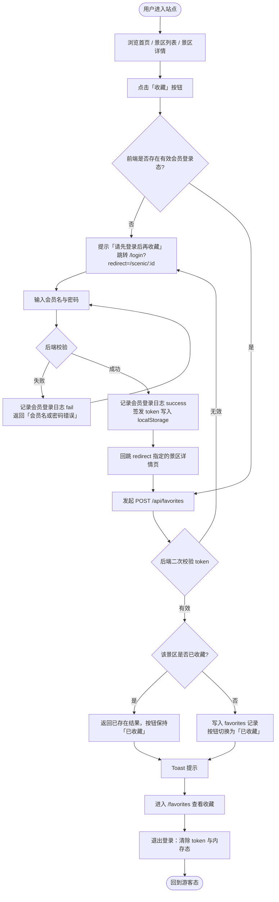
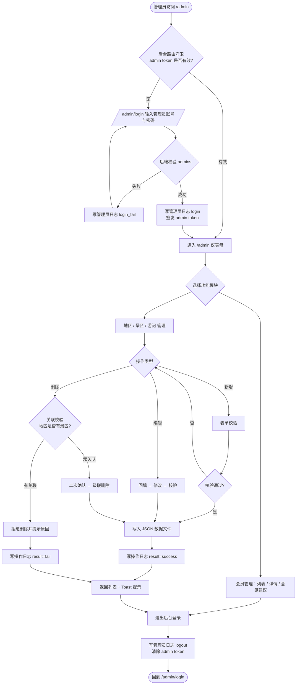

# e起去旅行 — 产品需求文档（PRD）

| 项目信息 | 内容 |
| --- | --- |
| 站点中文名 | **e起去旅行** |
| Slogan | **「e 键出发，风景在前」** |
| 项目代号 | `e-travel` |
| 文档版本 | v1.0（简单版 PRD，不含竞品分析） |
| 撰写人 | 许清楚（产品经理） |
| 语言 | 中文 |
| 技术栈基线 | Vite + React + MUI + Tailwind CSS（前端）／Node.js + Express + JSON 文件持久化（后端） |
| 需求来源 | 《软件用户业务流程.md》《软件管理员业务流程.md》《软件设计前端.md》《软件设计后端.md》 |

> 修订 r2：配图与种子数据规模按实际素材调整（8/8/8）。

> **需求边界声明**：本文档所有功能项均可溯源至上述 4 份原始需求文档。凡原始文档未明确、由产品经理合理补充的内容，均在对应条目备注中标注「**已假设**」，并在第 9 章汇总，供主理人确认。

---

## 1. 产品概述

### 1.1 一句话定位

一个面向中文游客的**旅游景区介绍 + 旅游攻略（游记）**轻量站点：游客在这里发现、检索、收藏心仪景区并阅读真实游记；管理员在后台维护全部内容。

### 1.2 目标用户

| 用户类型 | 画像 | 核心诉求 | 使用场景 |
| --- | --- | --- | --- |
| **出行前做攻略的游客**（C 端） | 18–45 岁，计划国内自由行，习惯用手机/PC 先搜再定 | 快速看清"这个景区值不值得去"：在哪、看什么、票多少、别人怎么玩；把想去的地方先存起来 | 周末前晚上、通勤路上，搜"九寨沟"→看简介与游记→收藏 |
| **站点内容管理员**（B 端） | 站点运营/内容维护人员，非技术人员 | 不写代码就能增删改地区、景区、游记；能看清会员情况与用户留言；操作有据可查 | 每周集中补内容、审核留言、排查会员登录异常 |

### 1.3 核心价值

1. **决策效率**：从一个关键词出发，3 次点击内看到景区的完整决策信息（位置 + 简介 + 门票 + 游记）。
2. **内容可生长**：地区 → 景区 → 游记三层内容结构，管理员可自助扩充，站点内容不依赖开发。
3. **可信与可追溯**：游记按景区聚合、留言直通后台、全量操作留痕，站点内容与行为均有记录。

### 1.4 设计约束与技术基线（供架构师）

| 编号 | 约束 | 说明 |
| --- | --- | --- |
| C-01 | **单一 SPA** | 前台与后台放在**同一个** Vite + React 单页应用中；C 端路由挂在 `/`，后台管理路由统一挂在 `/admin/*` |
| C-02 | **两套独立账号体系** | 后台管理员与前台会员是两套独立账号、独立登录态、独立 token 存储键；互不共享会话，前台登录不赋予任何后台权限 |
| C-03 | **后端形态** | Node.js + Express 提供 REST API；数据以 **JSON 文件**持久化（无外部数据库），进程内需做写入串行化避免并发写丢失 |
| C-04 | **单命令启动** | 一条命令同时拉起前端与后端（开发态由 Vite proxy 转发 `/api`），无需手动装配数据库或执行迁移脚本 |
| C-05 | **首次运行自举** | 数据文件缺失时自动初始化种子数据（含 1 个默认管理员、示例地区/景区/游记），保证首次访问即有内容、可登录 |
| C-06 | **图片素材** | 静态图片置于 `frontend/public/images/`，数据库仅存路径字符串（如 `/images/jiuzhaigou.png`）；**现有素材仅 9 张**（8 景区图 + 1 张关于图），地区/游记封面一律复用所属景区图；本次不做文件上传 |
| C-07 | **响应式** | 1440 / 1024 / 768 / 375 四档宽度下均可正常浏览与操作，后台管理以桌面端为主、移动端保证可用 |
| C-08 | **无第三方强依赖** | 不依赖短信、邮件、支付、地图 SDK 等外部服务；手机号/邮箱仅作为资料字段，不做真实验证 |

---

## 2. 用户角色与权限矩阵

### 2.1 角色定义

| 角色 | 标识 | 获得方式 | 登录入口 | 登录态存储键 |
| --- | --- | --- | --- | --- |
| **游客** | `guest` | 无需注册，访问即得 | — | — |
| **注册会员** | `member` | 前台 `/register` 自助注册 | `/login` | `etravel_member_token` |
| **管理员** | `admin` | 由种子数据/后台预置，不开放注册 | `/admin/login` | `etravel_admin_token` |

### 2.2 权限矩阵

| 能力 / 页面 | 游客 | 注册会员 | 管理员 |
| --- | :---: | :---: | :---: |
| 首页（推荐景区、推荐地区、搜索）`/` | ✅ | ✅ | ✅ |
| 景区列表与搜索 `/scenic` | ✅ | ✅ | ✅ |
| 景区详情 `/scenic/:id` | ✅ | ✅ | ✅ |
| 游记列表 / 游记详情 `/travels` `/travels/:id` | ✅ | ✅ | ✅ |
| 关于我们 / 联系我们 `/about` `/contact` | ✅ | ✅ | ✅ |
| 注册 `/register` | ✅ | ⛔（跳首页） | ⛔ |
| 登录 `/login` | ✅ | ⛔（跳首页） | ⛔ |
| 提交留言（意见建议） | ✅ 已假设：允许游客提交 | ✅ | ✅ |
| **收藏 / 取消收藏** | ⛔ 拦截 → 登录 | ✅ | — |
| 我的收藏 `/favorites` | ⛔ 拦截 → 登录 | ✅ | — |
| 退出前台登录 | — | ✅ | — |
| 后台登录 `/admin/login` | ✅ | ✅（但账号体系独立，会员账号无效） | ⛔ 已登录则直达仪表盘 |
| 后台全部页面 `/admin/*` | ⛔ 跳后台登录 | ⛔ 跳后台登录 | ✅ |
| 会员列表 / 会员详情 / 意见建议 | ⛔ | ⛔ | ✅ |
| 地区 / 景区 / 游记 增删改查 | ⛔ | ⛔ | ✅ |
| 日志管理（操作 / 管理员 / 会员登录） | ⛔ | ⛔ | ✅ |
| 修改自己的密码（后台） | ⛔ | ⛔ | ✅ |

**权限实现要求**

- 前台受限操作统一走「**前端拦截 + 后端二次校验**」：未登录点击收藏 → 前端提示并跳转 `/login?redirect=<当前路径>`；后端接口对无有效 token 请求返回 `401`。
- 后台路由由统一守卫组件拦截：无有效 admin token 一律重定向 `/admin/login?redirect=<原路径>`；后端 `/api/admin/*` 全部接口校验 admin token，越权返回 `403`。
- 管理员访问前台页面不获得任何会员特权（不会自动拥有收藏能力），体现 C-02 的两套体系隔离。

---

## 3. 用户故事

### 3.1 游客 / 注册会员（C 端）

| 编号 | 角色 | 用户故事 |
| --- | --- | --- |
| US-01 | 游客 | 作为游客，我希望在首页一眼看到推荐景区和推荐地区，以便快速找到值得去的目的地 |
| US-02 | 游客 | 作为游客，我希望在首页顶部输入景区名就能搜索，以便不用逐层点击就能直达目标 |
| US-03 | 游客 | 作为游客，我希望在景区列表页按地区筛选并翻页浏览，以便在"想去四川"这类模糊意图下发现更多选择 |
| US-04 | 游客 | 作为游客，我希望在景区详情页看到所在地区、开放时间、门票、交通和完整简介，以便判断是否值得专程前往 |
| US-05 | 游客 | 作为游客，我希望在景区详情页直接看到该景区的游记，以便了解别人的真实体验和玩法 |
| US-06 | 游客 | 作为游客，我希望在游记列表页浏览全部游记，以便在还没决定目的地时先被内容种草 |
| US-07 | 游客 | 作为游客，我希望在关于我们页了解站点定位、在联系我们页找到联系方式，以便判断这个站点是否可信 |
| US-08 | 游客 | 作为游客，我希望不登录也能提交留言/建议，以便随时反馈问题而不用先注册 |
| US-09 | 游客 | 作为游客，我希望点收藏时被引导登录并在登录后自动回到原景区，以便收藏动作不中断、不丢失上下文 |
| US-10 | 注册会员 | 作为注册会员，我希望只用会员名、密码、手机号、邮箱就能完成注册，以便低门槛获得收藏能力 |
| US-11 | 注册会员 | 作为注册会员，我希望用会员名和密码登录，并且刷新页面后仍保持登录，以便不用反复登录 |
| US-12 | 注册会员 | 作为注册会员，我希望在景区详情页一键收藏/取消收藏并看到按钮状态变化，以便确认操作生效 |
| US-13 | 注册会员 | 作为注册会员，我希望在"我的收藏"里看到我收藏过的全部景区并能直接取消收藏，以便管理我的旅行清单 |
| US-14 | 注册会员 | 作为注册会员，我希望收藏页在为空时给出引导，以便知道下一步该做什么 |
| US-15 | 注册会员 | 作为注册会员，我希望随时退出登录，以便在共用设备上保护账号 |

### 3.2 管理员（B 端）

| 编号 | 角色 | 用户故事 |
| --- | --- | --- |
| US-16 | 管理员 | 作为管理员，我希望用管理员账号密码登录后台，失败时可以重试，以便安全地进入管理区 |
| US-17 | 管理员 | 作为管理员，我希望登录后看到一个内容概览仪表盘，以便快速知道站点当前有多少地区、景区、游记和会员 |
| US-18 | 管理员 | 作为管理员，我希望在会员列表看到会员名、手机号、邮箱、注册时间和收藏数，并能搜索翻页，以便定位具体会员 |
| US-19 | 管理员 | 作为管理员，我希望点开会员详情查看其基本信息、收藏的景区与登录记录，以便了解这个会员的真实使用情况 |
| US-20 | 管理员 | 作为管理员，我希望在一个页面读到所有会员/游客提交的意见建议及处理状态，并能标记为已处理，以便不漏掉用户反馈 |
| US-21 | 管理员 | 作为管理员，我希望新增、编辑、删除、查看地区列表，以便维护站点的地区维度 |
| US-22 | 管理员 | 作为管理员，我希望在删除仍有景区归属的地区时被阻止并看到明确提示，以便不产生无归属的脏数据 |
| US-23 | 管理员 | 作为管理员，我希望新增、编辑、删除、查看景区（含封面、图集、门票、交通、简介、推荐标记），以便持续丰富站点内容 |
| US-24 | 管理员 | 作为管理员，我希望把某个景区设为/取消"推荐"，以便控制它是否出现在首页推荐位 |
| US-25 | 管理员 | 作为管理员，我希望在删除景区时被二次确认并告知会连带删除其游记与收藏记录，以便避免误删不可逆 |
| US-26 | 管理员 | 作为管理员，我希望新增、编辑、删除、查看游记（标题、所属景区、封面、作者、正文），以便为景区补充攻略内容 |
| US-27 | 管理员 | 作为管理员，我希望查看操作日志（谁在何时对哪个模块的哪条数据做了什么、成功与否），以便出现问题时可以追溯 |
| US-28 | 管理员 | 作为管理员，我希望查看管理员日志（登录、退出、改密事件），以便发现异常登录行为 |
| US-29 | 管理员 | 作为管理员，我希望查看会员登录日志（会员名、时间、IP、结果），以便排查会员账号问题 |
| US-30 | 管理员 | 作为管理员，我希望日志列表能按类型和时间范围筛选、分页，以便在海量记录里快速定位 |
| US-31 | 管理员 | 作为管理员，我希望用原密码验证后修改自己的密码，以便长期安全使用 |
| US-32 | 管理员 | 作为管理员，我希望修改密码后需要重新登录，以便确认新密码生效且会话安全 |
| US-33 | 管理员 | 作为管理员，我希望随时退出后台登录，以便在公共设备上结束会话 |

---

## 4. 需求池

> 优先级定义：**P0 = 必须交付**（直接对应 4 份原始需求文档，缺一不可）；**P1 = 体验增强**（P0 全部完成后按余量做）；**P2 = 可选，本次不做**（明确记录以免范围蔓延）。

### 4.1 P0 — 必须交付

#### 4.1.1 前台：用户模块

| 编号 | 模块 | 需求描述 | 验收标准 |
| --- | --- | --- | --- |
| F-01 | 用户模块 | 会员注册：填写会员名、密码、确认密码、手机号、邮箱，提交后创建会员并自动登录 | ①5 个字段均为必填，缺失时对应输入框下方出现中文错误提示且不发请求；②会员名已存在时返回明确提示"该会员名已被注册"；③两次密码不一致时前端拦截；④注册成功后自动登录并跳转首页，顶栏显示会员名 |
| F-02 | 用户模块 | 会员登录：会员名 + 密码，成功后签发前台 token 并落地本地存储 | ①账号或密码错误时提示"会员名或密码错误"且可继续重试；②登录成功后顶栏由"登录/注册"变为会员名与退出入口；③刷新页面后登录态不丢失；④支持 `?redirect=` 回跳参数 |
| F-03 | 用户模块 | 退出前台登录：清除本地 token 与内存态 | 点退出后顶栏恢复"登录/注册"，再访问 `/favorites` 会被拦截到登录页 |
| F-04 | 用户模块 | 前台登录态持久化：token 存于 `localStorage.etravel_member_token`，应用启动时校验有效性 | 关闭浏览器重开站点仍处于登录态；token 失效时自动降级为游客且不报错 |

#### 4.1.2 前台：首页

| 编号 | 模块 | 需求描述 | 验收标准 |
| --- | --- | --- | --- |
| F-05 | 首页 | 推荐景区展示：读取被标记为推荐的景区，最多 6 个，卡片展示封面图、名称、所在地区、简介摘要（截断 40 字） | ①与后台"设为推荐"状态实时一致；②卡片可点击进入景区详情；③无推荐数据时显示空态文案"暂无推荐景区" |
| F-06 | 首页 | 推荐地区展示：展示地区（最多 6 个），含封面图、地区名、该地区景区数量 | ①景区数量按实际归属景区实时计算；②点击进入景区列表并自动带上该地区筛选条件 |
| F-07 | 首页 | 搜索景区：顶部搜索框输入关键词，回车或点按钮提交 | ①按景区名称/简介包含关键词匹配；②跳转 `/scenic?keyword=<词>` 并展示结果；③关键词为空时不跳转、就地提示"请输入景区名称" |
| F-08 | 首页 | 全局导航与页脚：顶栏含首页、景区、游记、我的收藏、关于我们，右侧为登录/注册或会员菜单；页脚含站点名、slogan、快捷链接、版权 | ①当前页面对应导航项高亮；②4 档宽度下导航可用（窄屏折叠为抽屉菜单）；③页脚在内容不足一屏时仍贴底 |

#### 4.1.3 前台：景区模块

| 编号 | 模块 | 需求描述 | 验收标准 |
| --- | --- | --- | --- |
| F-09 | 景区模块 | 景区列表与搜索：支持关键词搜索、按地区筛选、分页（每页 9 条），卡片式展示 | ①`?keyword=`、`?regionId=`、`?page=` 三个 URL 参数可组合且刷新后状态保持；②结果为空时显示"没有找到相关景区"并提供清空筛选按钮；③分页总条数、当前页正确显示 |
| F-10 | 景区模块 | 景区详情：展示封面大图与图集、名称、所在地区、开放时间、门票参考、交通指引、简介（多段）、推荐标签 | ①字段为空时该行整行隐藏而非显示"undefined/空"；②不存在的 id 显示 404 页面并给返回首页按钮；③页面底部展示该景区关联游记 |
| F-11 | 景区模块 | 收藏景区（含未登录拦截）：点击收藏写入收藏记录，按钮切换为"已收藏" | ①未登录时跳 `/login?redirect=/scenic/:id` 并提示"请先登录后再收藏"；②登录成功回跳后按钮变为"已收藏"；③已收藏再点击变为取消收藏，接口幂等（不产生重复记录）；④成功后 Toast 提示 |
| F-12 | 景区模块 | 取消收藏：在详情页或收藏页取消 | 取消后按钮回到"收藏"，收藏页列表中该条消失，后台会员详情的收藏数同步减 1 |
| F-13 | 景区模块 | 景区详情关联游记：按 `scenicId` 查该景区游记，按发布时间倒序，最多展示 5 条并给"查看全部" | 无游记时显示"该景区暂无游记"，不出现空白区块 |
| F-14 | 景区模块 | 游记列表：展示全部游记，卡片含封面、标题、所属景区名、作者、发布时间 | ①按发布时间倒序；②支持按景区筛选；③分页每页 6 条 |
| F-15 | 景区模块 | 游记详情：标题、封面、所属景区（可点击跳景区）、作者会员名、发布时间、正文按段落渲染 | 正文换行正确渲染为段落；不存在的 id 显示 404 |

#### 4.1.4 前台：我的收藏 / 关于我们 / 联系我们

| 编号 | 模块 | 需求描述 | 验收标准 |
| --- | --- | --- | --- |
| F-16 | 用户模块 | 我的收藏页：受保护页面，列出当前会员收藏的景区（封面、名称、地区、收藏时间），可取消收藏 | ①未登录访问被重定向到 `/login?redirect=/favorites`；②空列表显示引导"还没有收藏，去逛逛景区"+ 跳转按钮；③取消收藏后列表即时更新且不整页刷新 |
| F-17 | 关于我们 | 关于我们页：站点介绍、slogan、内容数据概览（地区数/景区数/游记数）、服务承诺 | 数据概览数字与后端实际统计一致；页面为纯静态内容区，无外部依赖 |
| F-18 | 联系我们 | 联系我们页：展示联系邮箱、客服电话（展示型）、工作时间、站点地址 | 联系方式以文字/图标展示，点击邮箱可唤起邮件客户端（`mailto:`） |
| F-19 | 联系我们 | 留言表单（意见建议）：昵称、联系方式、留言内容，提交后写入意见反馈，后台"意见建议"可见 | ①三项必填、内容限制 5–300 字；②提交成功显示"感谢反馈，我们会尽快处理"并清空表单；③后台意见建议列表 10 秒内可看到该条（已假设：不做审核） |

#### 4.1.5 后台：管理员模块

| 编号 | 模块 | 需求描述 | 验收标准 |
| --- | --- | --- | --- |
| F-20 | 管理员模块 | 后台登录：管理员账号 + 密码，失败可重试，成功签发后台 token | ①失败提示"账号或密码错误"并可无限重试；②成功后跳 `/admin` 仪表盘；③登录成功/失败均写入管理员日志 |
| F-21 | 管理员模块 | 后台路由守卫：所有 `/admin/*`（除登录页）均校验 admin token | 未登录直接访问 `/admin/scenics` 被重定向到 `/admin/login?redirect=/admin/scenics`；已登录访问 `/admin/login` 自动跳仪表盘 |
| F-22 | 管理员模块 | 修改密码：输入原密码、新密码、确认新密码 | ①原密码错误时提示且不改；②新密码长度 6–20，两次不一致即拦截；③成功后强制登出并跳后台登录页并提示"密码已修改，请重新登录"；④写入管理员日志 |
| F-23 | 管理员模块 | 退出后台登录：清除后台 token | 退出后访问任意 `/admin/*` 均被拦截，写入管理员日志（LOGOUT） |

#### 4.1.6 后台：管理框架与仪表盘

| 编号 | 模块 | 需求描述 | 验收标准 |
| --- | --- | --- | --- |
| F-24 | 后台框架 | 后台布局：左侧固定侧边栏（仪表盘/会员管理/地区管理/景区管理/游记管理/日志管理/修改密码）+ 顶栏（站点名、当前管理员、退出） | ①当前路由对应菜单项高亮；②侧边栏在窄屏可折叠为图标栏；③后台样式与前台视觉体系一致但更克制（信息密度优先） |
| F-25 | 后台框架 | 仪表盘概览：地区数、景区数、游记数、会员数、意见建议数、今日会员登录次数，并提供各模块快捷入口（已假设） | 6 个数字与后端统计接口一致；点击卡片可跳转对应列表页 |

#### 4.1.7 后台：会员管理 + 意见建议

| 编号 | 模块 | 需求描述 | 验收标准 |
| --- | --- | --- | --- |
| F-26 | 会员管理 | 会员列表：表格展示 ID、会员名、手机号、邮箱、收藏数、注册时间，支持按会员名/手机号搜索与分页（每页 10 条） | ①列头可点击切换排序（ID/注册时间）；②搜索为模糊匹配；③无结果时表格内显示空态行 |
| F-27 | 会员管理 | 会员详情：基本信息、该会员收藏的景区列表、最近 10 条登录记录 | ①收藏列表与前台一致；②会员不存在时显示"会员不存在"并提供返回列表；③支持从详情返回列表且保留原搜索条件 |
| F-28 | 意见建议 | 意见建议列表：展示昵称、联系方式、内容（超长折叠可展开）、提交时间、处理状态，支持分页 | ①按提交时间倒序；②内容超过 100 字时默认截断并给"展开/收起" |
| F-29 | 意见建议 | 处理状态管理：将某条意见建议标记为"已处理"/"未处理" | 状态变更即时生效并持久化；已处理条目显示绿色标签，未处理显示橙色标签 |

#### 4.1.8 后台：地区管理

| 编号 | 模块 | 需求描述 | 验收标准 |
| --- | --- | --- | --- |
| F-30 | 地区管理 | 地区列表：表格展示 ID、地区名称、封面（缩略图）、简介、景区数、排序值、创建时间 | 景区数按实际归属实时统计；列表支持首页推荐位状态提示（是否进入首页推荐） |
| F-31 | 地区管理 | 添加地区：名称（必填，唯一）、封面图路径、简介、排序值 | ①名称为空或重复时给明确中文提示；②封面支持填写 `/images/jiuzhaigou.png` 这类已有素材路径并**实时预览**（仅允许选用 `public/images/` 下已存在的 9 张图）；③提交成功后回到列表并 Toast 提示 |
| F-32 | 地区管理 | 编辑地区：回填原值后修改 | ①保存后列表即时更新；②名称改为与其他地区重复时被拦截；③取消编辑可回退且不写入 |
| F-33 | 地区管理 | 删除地区：二次确认弹窗 | ①该地区下存在景区时**拒绝删除**并提示"该地区下还有 N 个景区，请先处理"；②无关联时确认后删除成功；③删除写入操作日志 |

#### 4.1.9 后台：景区管理

| 编号 | 模块 | 需求描述 | 验收标准 |
| --- | --- | --- | --- |
| F-34 | 景区管理 | 景区列表：表格展示 ID、封面缩略图、名称、所在地区、门票、推荐标记、创建时间，支持关键词与地区筛选、分页（每页 10 条） | ①筛选条件可组合；②推荐景区有醒目标记；③新增按钮固定在列表右上方 |
| F-35 | 景区管理 | 添加景区：名称（必填）、所属地区（下拉必选）、封面图、图集（多张路径，逗号或换行分隔）、开放时间、门票参考、交通指引、简介（多段）、是否推荐 | ①名称与地区未填时逐项报错；②所属地区下拉选项来自地区表，无地区时提示"请先添加地区"并给跳转；③图集至少可添加 1 张并预览；④提交成功写入并发操作日志 |
| F-36 | 景区管理 | 编辑景区：回填全部字段后修改 | 字段校验规则与添加一致；保存后前台详情页数据同步更新 |
| F-37 | 景区管理 | 删除景区：二次确认 + 级联说明 | ①弹窗明示"将同时删除该景区的 N 篇游记及 M 条收藏记录"；②确认后级联删除并写操作日志；③删除后前台访问该详情返回 404 |
| F-38 | 景区管理 | 推荐开关：列表内一键设为/取消推荐 | 状态切换即时生效；首页推荐位最多 6 个，超出时按更新时间取前 6 并提示管理员 |

#### 4.1.10 后台：游记管理

| 编号 | 模块 | 需求描述 | 验收标准 |
| --- | --- | --- | --- |
| F-39 | 游记管理 | 游记列表：表格展示 ID、封面缩略图、标题、所属景区、作者、发布时间，支持按标题/景区筛选、分页（每页 10 条） | 筛选与分页组合可用；列表可直接跳转前台预览 |
| F-40 | 游记管理 | 添加游记：标题（必填）、所属景区（必选）、封面图、作者会员（可选，默认"站点编辑"）、正文（多段必填）、发布时间（默认当前时间） | 标题、景区、正文缺失时逐项报错；正文支持换行分段；提交写操作日志 |
| F-41 | 游记管理 | 编辑游记：回填后修改 | 保存后前台游记详情同步更新；修改发布时间可调整前台排序 |
| F-42 | 游记管理 | 删除游记：二次确认 | 删除后前台游记列表与景区详情关联区同步消失；写操作日志 |

#### 4.1.11 后台：日志管理

| 编号 | 模块 | 需求描述 | 验收标准 |
| --- | --- | --- | --- |
| F-43 | 日志管理 | 操作日志：记录管理员对地区/景区/游记的增、改、删动作，字段含时间、管理员、模块、动作类型、对象标识、结果 | 每次 CRUD 成功后自动产生 1 条；删除失败（如地区占用）也记录且结果为失败并附原因 |
| F-44 | 日志管理 | 管理员日志：记录管理员登录成功/失败、退出、修改密码事件 | 登录失败也记录（含失败原因）；字段含时间、管理员账号、事件、IP、结果 |
| F-45 | 日志管理 | 会员登录日志：记录会员登录成功/失败，字段含时间、会员名、IP、结果 | 每次前台登录尝试均产生记录；失败的会员名也要记录 |
| F-46 | 日志管理 | 日志页三 Tab（操作/管理员/会员登录）+ 时间范围筛选 + 分页（每页 20 条） | ①三个 Tab 独立维护各自的筛选与页码；②时间范围支持开始/结束日期；③日志只读，不提供编辑与删除入口 |

**P0 合计：46 条**

### 4.2 P1 — 体验增强（P0 全部完成后按余量实现）

| 编号 | 模块 | 需求描述 | 验收标准 |
| --- | --- | --- | --- |
| F-47 | 景区模块 | 景区列表排序：最新 / 收藏最多 / 推荐优先 三种排序切换 | 切换排序后 URL 带 `?sort=` 且刷新保持 |
| F-48 | 首页 | 首页主视觉横幅：1 张大图 + slogan + 搜索框复合区 | 首屏 600px 内可见搜索框，375px 宽度下不溢出 |
| F-49 | 景区模块 | 景区浏览量统计：详情页访问计数，首页/列表可展示"热门"标记 | 计数按会话去重（同会话 30 分钟内只计 1 次） |
| F-50 | 全局 | 加载态与骨架屏：列表与详情加载时展示骨架占位而非空白 | 首屏请求未返回时无布局跳动（CLS 明显降低） |
| F-51 | 后台 | 列表批量删除：景区/游记列表支持多选批量删除 | 批量删除逐条产日志，失败的条目单独提示 |
| F-52 | 后台 | 图片路径实时预览缩略图（表单内） | 输入合法路径后 300ms 内出现预览；路径无效显示占位图 |
| F-53 | 日志管理 | 日志导出 CSV | 导出内容遵循当前筛选条件，文件名含日期 |
| F-54 | 前台 | 前台 404 与错误边界页：统一视觉、可返回首页 | 任意非法路由显示 404 而非白屏 |

**P1 合计：8 条**

### 4.3 P2 — 可选，本次不做

| 编号 | 模块 | 需求描述 | 不做原因 |
| --- | --- | --- | --- |
| F-55 | 游记模块 | 前台会员投稿游记 + 后台审核流 | 原始需求中游记仅由管理员维护，超出本期边界 |
| F-56 | 景区模块 | 景区评分与评论 | 需评分体系与反作弊，本期无需求来源 |
| F-57 | 扩展 | 行程规划 / 路线推荐 | 需求文档未涉及 |
| F-58 | 会员模块 | 会员头像、个人资料编辑、忘记密码重置 | 需要邮件服务，违反 C-08 |
| F-59 | 后台 | 多管理员与角色分权（编辑/审核） | 本期仅单一管理员角色 |
| F-60 | 后台 | 图片文件上传（替代路径填写） | 需文件存储，违反 C-06 |
| F-61 | 后台 | 数据看板可视化图表（趋势折线、地区分布） | 属增值功能，本期以数字概览替代 |

**P2 合计：7 条**

> **需求条目总计 61 条**：P0 46 / P1 8 / P2 7。

---

## 5. 页面清单与 UI 设计稿（文字版）

**页面总数：24 个**（C 端 11 个含 404，B 端 13 个）。

### 5.1 C 端页面（路由在 `/` 下）

#### P-01 首页 `/`
- **目的**：3 秒内让游客明白"这是个找景区、看游记的站点"，并提供两个主入口（搜索 / 推荐）。
- **布局（自上而下）**：
  1. 顶部导航栏（logo「e起去旅行」+ 导航 + 搜索框 + 登录/注册/会员菜单）
  2. 首屏横幅：背景图复用推荐景区大图（如 `/images/jiuzhaigou.png`，叠加 40% 深色蒙层），标题 slogan「e 键出发，风景在前」，副标题一句话定位，居中搜索框
  3. 「推荐景区」区块：区块标题 + 右侧「查看全部 →」，下方 3×2 卡片网格（封面 16:9、名称、地区标签、简介摘要）
  4. 「推荐地区」区块：6 个地区卡片（封面图 + 地区名 + "N 个景区"），2 行 3 列
  5. 「最新游记」区块（已假设：增强首页信息密度）：3 条横向卡片
  6. 页脚
- **关键组件**：`Navbar`、`HeroSearch`、`ScenicCard`、`RegionCard`、`TravelCard`、`Footer`
- **空态 / 错误态**：推荐景区或地区为空 → 区块内灰色空态卡"暂无推荐，内容正在补充中"；接口失败 → 区块内"加载失败，点击重试"
- **跳转**：搜景区 → `/scenic?keyword=`；景区卡 → `/scenic/:id`；地区卡 → `/scenic?regionId=`；游记卡 → `/travels/:id`

#### P-02 景区列表 / 搜索结果 `/scenic`
- **目的**：承载搜索与筛选结果，让游客横向比较多个景区。
- **布局**：导航栏 → 面包屑（首页 / 景区）→ 结果标题区（"搜索结果：九寨沟" 或 "全部景区"，右侧显示"共 N 个"）→ 左侧筛选栏（地区单选列表 + 清空筛选）／右侧 3 列卡片网格（窄屏折叠为顶部横向筛选条）→ 分页器 → 页脚
- **关键组件**：`FilterSidebar`、`ScenicCard`、`Pagination`、`EmptyState`
- **空态 / 错误态**：无结果 → 居中插图 + "没有找到相关景区" + "清空筛选条件"按钮 + 推荐 4 个热门景区
- **跳转**：卡片 → `/scenic/:id`

#### P-03 景区详情 `/scenic/:id`
- **目的**：一站式回答"这个景区值不值得去"。
- **布局**：
  1. 导航栏
  2. 顶部图片区：左侧大图（该景区独占图，如 `/images/jiuzhaigou.png`）+ 右侧 2 张小图（复用同一张图，用不同 `object-position` 裁切），移动端为可滑动轮播
  3. 标题区：景区名（H1）+ 推荐标签 + 地区标签（可点击跳筛选）+ 右侧「收藏 / 已收藏」主按钮
  4. 信息条：开放时间 / 门票参考 / 交通指引（三列图标+文字）
  5. 正文区：左 2/3「景区简介」（多段），右 1/3 侧边卡（所在地区卡：封面 + 简介 + "查看更多该地区景区"）
  6. 「本景区游记」区块：最多 5 条游记卡片 + 「查看全部游记」
  7. 页脚
- **关键组件**：`ImageGallery`、`FavoriteButton`、`InfoBar`、`TravelCard`、`RegionAside`
- **空态 / 错误态**：字段缺失则整行隐藏；无游记 → "该景区暂无游记"；id 不存在 → P-11 404
- **跳转**：收藏（未登录）→ `/login?redirect=/scenic/:id`；游记 → `/travels/:id`；地区 → `/scenic?regionId=`

#### P-04 游记列表 `/travels`
- **目的**：内容种草，让还没定目的地的游客先被游记吸引。
- **布局**：导航栏 → 页面标题「旅行游记」+ 副标题 → 景区筛选下拉（全部景区 / 指定景区）→ 2 列游记卡片（封面、标题、所属景区标签、作者、日期）→ 分页 → 页脚
- **关键组件**：`TravelCard`、`ScenicFilterSelect`、`Pagination`
- **空态 / 错误态**：无游记 → "暂无游记，敬请期待"
- **跳转**：卡片 → `/travels/:id`；景区标签 → `/scenic/:id`

#### P-05 游记详情 `/travels/:id`
- **目的**：让读者读完一篇完整攻略并顺势进入对应景区。
- **布局**：导航栏 → 面包屑（首页 / 游记 / 标题）→ 标题 + 元信息（作者、发布时间、所属景区标签）→ 封面大图 → 正文（最大宽度 760px 居中，段落间距 1.5em）→ 底部「所属景区」引导卡（封面 + 名称 + 简介 + "查看景区详情"按钮）→ 相关游记 3 条 → 页脚
- **关键组件**：`ArticleBody`、`ScenicCalloutCard`、`TravelCard`
- **空态 / 错误态**：id 不存在 → 404；正文为空 → 显示"内容整理中"
- **跳转**：所属景区 → `/scenic/:id`

#### P-06 登录 `/login`
- **目的**：低摩擦完成会员登录，并承接收藏拦截的回跳。
- **布局**：左侧 55% 图片区（复用景区图，如 `/images/westlake.png` + slogan），右侧 45% 表单卡（标题「欢迎回来」、会员名、密码、登录按钮、底部"还没有账号？立即注册"）；窄屏隐藏图片区
- **关键组件**：`LoginForm`、`AuthLayout`
- **空态 / 错误态**：字段空 → 输入框下红字提示；账号密码错 → 表单顶部 Alert "会员名或密码错误"；提交中按钮 loading 且禁用
- **跳转**：成功后 → `redirect` 参数指定页，无参数则 `/`；「立即注册」→ `/register`；若已登录访问 → 自动跳 `/`

#### P-07 注册 `/register`
- **目的**：4 个字段完成注册，立即获得收藏能力。
- **布局**：与登录页同一 `AuthLayout`，表单卡含会员名、密码、确认密码、手机号、邮箱、注册按钮，底部"已有账号？去登录"
- **关键组件**：`RegisterForm`
- **空态 / 错误态**：逐字段校验（会员名 2–20 字、密码 6–20 位、手机号 11 位、邮箱格式）；会员名重复 → 对应字段下方提示"该会员名已被注册"
- **跳转**：成功后自动登录并跳 `/`；「去登录」→ `/login`

#### P-08 我的收藏 `/favorites`
- **目的**：会员的"想去清单"，可管理、可移除。
- **布局**：导航栏 → 页头（标题「我的收藏」+ 副标题"共 N 个景区"）→ 3 列景区卡片网格（右上角浮动"取消收藏"图标按钮、卡片显示收藏时间）→ 页脚
- **关键组件**：`ScenicCard`（含 `onRemove`）、`EmptyState`
- **空态 / 错误态**：空 → 大幅空态："还没有收藏任何景区" + 说明文字 + 「去逛逛景区」按钮；未登录 → 重定向 `/login?redirect=/favorites`
- **跳转**：卡片 → `/scenic/:id`；取消收藏 → 就地移除 + Toast「已取消收藏」

#### P-09 关于我们 `/about`
- **目的**：建立信任，说明站点是什么、谁在做。
- **布局**：导航栏 → 页头标题「关于我们」+ slogan → 站点主视觉配图 `/images/about.png`（全宽、21:9 裁切）→ 两栏内容（左：站点介绍 3 段文字；右：数据概览卡：地区 N / 景区 N / 游记 N）→ 「我们相信」三条价值主张（图标+标题+一句描述）→ 页脚
- **关键组件**：`PageHeader`、`StatCard`
- **空态 / 错误态**：统计接口失败 → 数字显示「—」不影响正文
- **跳转**：底部 CTA → `/contact`

#### P-10 联系我们 `/contact`
- **目的**：提供联系方式 + 承接意见建议提交。
- **布局**：导航栏 → 页头「联系我们」→ 左 1/3 联系信息卡（邮箱、电话、工作时间、地址，每项图标+文字）／右 2/3 留言表单卡（昵称、联系方式、留言内容 textarea + 字数计 0/300、提交按钮）→ 页脚
- **关键组件**：`ContactInfoPanel`、`FeedbackForm`
- **空态 / 错误态**：必填未填 → 逐项提示；内容少于 5 字 → "请至少输入 5 个字"；提交成功 → 表单替换为成功态（勾选图标 + "感谢反馈，我们会尽快处理" + "再写一条"按钮）
- **跳转**：提交后停在原页（不出跳）

#### P-11 404 `/404` 与兜底路由 `*`
- **目的**：任何非法路径不白屏。
- **布局**：导航栏 → 居中插图 + 「找不到这个页面」+ 说明 + 「回到首页」/「去逛景区」双按钮 → 页脚
- **跳转**：`/`、`/scenic`

### 5.2 B 端页面（路由在 `/admin/*` 下）

#### P-12 后台登录 `/admin/login`
- **目的**：独立的管理员身份入口，与前台完全隔离。
- **布局**：居中卡片式（不套用后台侧边栏布局）：站点标 + 「管理后台」标题 + 管理员账号、密码 + 登录按钮；页脚一行小字"仅限授权管理员使用"
- **关键组件**：`AdminLoginForm`
- **空态 / 错误态**：错误 → 卡片内 Alert "账号或密码错误" 并可重试；提交中 loading
- **跳转**：成功 → `/admin` 或 `redirect` 参数；已登录访问 → 自动跳 `/admin`

#### P-13 后台仪表盘 `/admin`
- **目的**：一屏掌握站点规模，作为所有管理动作的起点。
- **布局**：后台框架（侧边栏 + 顶栏）→ 页面标题「仪表盘」+ 欢迎语（当前管理员名）→ 6 个统计卡（地区 / 景区 / 游记 / 会员 / 意见建议 / 今日会员登录）→ 「快捷操作」区（新增地区、新增景区、新增游记、查看待处理意见）→ 「最近操作日志」列表（最新 8 条：时间 + 管理员 + 动作 + 对象）
- **关键组件**：`AdminLayout`、`StatCard`、`QuickActionGrid`、`RecentLogList`
- **空态 / 错误态**：统计失败 → 卡片显示「—」并顶部 Alert 可重试；无日志 → "暂无操作记录"
- **跳转**：统计卡 → 对应列表页；快捷操作 → 对应新增表单

#### P-14 会员列表 `/admin/members`
- **目的**：定位与查看会员。
- **布局**：后台框架 → 页头（「会员管理」+ 共 N 人）→ 工具条（搜索框：会员名/手机号；重置按钮）→ 表格（ID、会员名、手机号、邮箱、收藏数、注册时间、操作「查看」）→ 分页
- **关键组件**：`DataTable`、`SearchBar`、`Pagination`
- **空态 / 错误态**：搜索无结果 → 表格内"没有符合条件的会员"；接口失败 → Alert + 重试
- **跳转**：查看 → `/admin/members/:id`

#### P-15 会员详情 `/admin/members/:id`
- **目的**：看清单个会员的资料、收藏与登录行为。
- **布局**：后台框架 → 面包屑（会员管理 / 会员名）→ 左：资料卡（会员名、手机、邮箱、注册时间、收藏数）／右：该会员「收藏的景区」标签列表 + 「最近登录记录」小表格（时间、IP、结果）→ 底部「返回列表」
- **关键组件**：`ProfileCard`、`FavoriteTagList`、`MiniTable`
- **空态 / 错误态**：无收藏 → "该会员还没有收藏"；无登录记录 → "暂无登录记录"；id 不存在 → "会员不存在" + 返回按钮
- **跳转**：收藏的景区 → 前台 `/scenic/:id`（新标签页）；返回 → 列表并保留原搜索条件

#### P-16 意见建议 `/admin/feedbacks`
- **目的**：集中处理用户反馈，不漏单。
- **布局**：后台框架 → 页头（「意见建议」+ 待处理 N 条）→ 状态筛选（全部 / 未处理 / 已处理）→ 卡片列表（每卡：状态标签、昵称 + 联系方式、内容（>100 字折叠）、提交时间、右下「标记已处理 / 标记未处理」）→ 分页
- **关键组件**：`FeedbackCard`、`StatusChip`、`Pagination`
- **空态 / 错误态**：无数据 → "暂无意见建议"；切换状态中按钮 loading
- **跳转**：不跳页，就地更新状态

#### P-17 地区管理 `/admin/regions`
- **目的**：维护地区维度（首页推荐与景区归属的基础）。
- **布局**：后台框架 → 页头（「地区管理」+ 共 N 个 + 右侧「＋ 添加地区」主按钮）→ 表格（ID、封面缩略图、地区名称、简介摘要、景区数、排序值、创建时间、操作「编辑 / 删除」）→ 分页
- **关键组件**：`DataTable`、`ThumbCell`、`ConfirmDialog`
- **空态 / 错误态**：无地区 → 空态行 + "还没有地区，先添加一个吧" + 添加按钮；删除被占用 → 弹窗提示"该地区下还有 N 个景区，请先处理"且不删除
- **跳转**：添加 → `/admin/regions/new`；编辑 → `/admin/regions/:id/edit`

#### P-18 地区表单（新增 / 编辑）`/admin/regions/new`、`/admin/regions/:id/edit`
- **目的**：一个表单承载地区的创建与修改。
- **布局**：后台框架 → 面包屑（地区管理 / 添加地区｜编辑地区）→ 单列表单卡：地区名称*、封面图路径（含实时预览框 16:9）、简介（textarea）、排序值（数字，默认 0）→ 底部「保存」主按钮 + 「取消」
- **关键组件**：`RegionForm`、`ImagePathInput`（带预览）
- **空态 / 错误态**：名称为空 → "请输入地区名称"；重名 → "该地区名称已存在"；编辑态 id 不存在 → "地区不存在"
- **跳转**：保存成功 → `/admin/regions` + Toast；取消 → 返回列表（有未保存改动时二次确认）

#### P-19 景区管理 `/admin/scenics`
- **目的**：站点最核心内容的批量维护。
- **布局**：后台框架 → 页头（「景区管理」+ 共 N 个 + 右侧「＋ 添加景区」）→ 工具条（关键词搜索、地区下拉筛选、重置）→ 表格（ID、封面缩略、名称、所在地区、门票参考、推荐开关、创建时间、操作「编辑 / 删除」）→ 分页
- **关键组件**：`DataTable`、`RecommendSwitch`、`ConfirmDialog`
- **空态 / 错误态**：无数据 → 空态行 + 添加按钮；推荐开关失败 → Toast 错误并回滚开关状态
- **跳转**：添加 → `/admin/scenics/new`；编辑 → `/admin/scenics/:id/edit`

#### P-20 景区表单（新增 / 编辑）`/admin/scenics/new`、`/admin/scenics/:id/edit`
- **目的**：结构化录入景区全部展示字段。
- **布局**：后台框架 → 面包屑 → 左右两栏表单（左 2/3 主信息：景区名称*、所属地区*（下拉）、图集路径（多行/标签式增删 + 缩略图预览）、开放时间、门票参考、交通指引、景区简介（textarea 多段）；右 1/3 侧栏：封面图路径 + 预览、是否推荐（Switch）、保存/取消按钮吸底）→ 全宽底部操作条
- **关键组件**：`ScenicForm`、`RegionSelect`、`ImagePathInput`、`GalleryPathInput`、`FormSection`
- **空态 / 错误态**：名称/地区缺失 → 逐项红字；地区表为空 → 下拉禁用并提示"请先添加地区"+「去添加」链接；图集路径无效 → 预览显示占位图 + 微提示
- **跳转**：保存成功 → `/admin/scenics` + Toast；取消 → 返回列表（未保存改动二次确认）

#### P-21 游记管理 `/admin/travels`
- **目的**：维护攻略内容。
- **布局**：后台框架 → 页头（「游记管理」+ 共 N 篇 + 右侧「＋ 添加游记」）→ 工具条（标题关键词、景区下拉筛选）→ 表格（ID、封面缩略、标题、所属景区、作者、发布时间、操作「前台预览 / 编辑 / 删除」）→ 分页
- **关键组件**：`DataTable`、`FilterBar`、`ConfirmDialog`
- **空态 / 错误态**：无数据 → 空态行；删除 → 二次确认"删除后不可恢复"
- **跳转**：预览 → 前台 `/travels/:id`（新标签页）；添加/编辑 → 表单页

#### P-22 游记表单（新增 / 编辑）`/admin/travels/new`、`/admin/travels/:id/edit`
- **目的**：快速录入一篇有封面的攻略。
- **布局**：后台框架 → 面包屑 → 表单：标题*（全宽）、所属景区*（下拉）、作者会员（可选下拉 + 默认"站点编辑"）、发布时间（日期时间，默认当前）、封面图路径 + 预览、正文*（大 textarea，支持换行分段，显示字数）→ 保存/取消
- **关键组件**：`TravelForm`、`ScenicSelect`、`ImagePathInput`
- **空态 / 错误态**：标题/景区/正文缺失逐项提示；正文 < 10 字提示"内容太短"；景区表为空 → 提示"请先在景区管理中添加景区"
- **跳转**：保存成功 → `/admin/travels` + Toast

#### P-23 日志管理 `/admin/logs`
- **目的**：全站行为可追溯，三类日志统一入口。
- **布局**：后台框架 → 页头「日志管理」→ 三 Tab（操作日志｜管理员日志｜会员登录日志）→ 工具条（开始日期、结束日期、重置；只读无删除）→ 表格（列随 Tab 变化）→ 分页
  - 操作日志列：时间、管理员、模块、动作（新增/编辑/删除）、对象标识、结果（含失败原因 tooltip）
  - 管理员日志列：时间、管理员账号、事件（登录/登录失败/退出/改密）、IP、结果
  - 会员登录日志列：时间、会员名、IP、结果
- **关键组件**：`LogTabs`、`DateRangeFilter`、`DataTable`
- **空态 / 错误态**：筛选无结果 → "该时间段没有记录"；Tab 切换保留各自筛选状态
- **跳转**：无下级页面（叶子页）

#### P-24 修改密码 `/admin/password`
- **目的**：管理员自助改密并强制重登。
- **布局**：后台框架 → 页头「修改密码」→ 居中窄卡片表单：原密码、新密码、确认新密码（均密码框 + 显隐切换）+ 密码规则提示文字 + 「确认修改」按钮
- **关键组件**：`PasswordForm`
- **空态 / 错误态**：原密码错 → "原密码不正确"；新密码不符规则 → 就地提示；两次不一致 → "两次输入的新密码不一致"；成功 → 全局提示 + 自动登出跳 `/admin/login`
- **跳转**：成功后 → `/admin/login`

### 5.3 全局交互约定

| 场景 | 约定 |
| --- | --- |
| 加载态 | 列表用骨架屏（P1 后）；P0 阶段用居中 CircularProgress；按钮提交期间 disabled + loading |
| 成功反馈 | 右下角 Snackbar/Toast，2.5s 自动消失 |
| 失败反馈 | 表单级错误就地展示；接口/网络错误用顶部 Alert，含「重试」 |
| 危险操作 | 删除一律二次确认弹窗，确认按钮为警示色，文案须说明后果 |
| 空态 | 统一使用「插图 + 一句说明 + 一个主操作按钮」结构 |
| 返回保留状态 | 列表 → 详情 → 返回时保留原搜索/筛选/页码（通过 URL query 承载） |

---

## 6. 数据实体草案

> 说明：以下为供架构师细化为 JSON Schema 的字段草案。所有实体均含 `id`（字符串或自增数字，由架构师统一）、`createdAt`、`updatedAt`（ISO 8601 字符串）。**必填**列标注 ✅ 的字段在接口层必须校验。

### 6.1 会员 `members`

| 字段 | 类型 | 必填 | 说明 |
| --- | --- | :---: | --- |
| `id` | number | ✅ | 主键，自增 |
| `username` | string | ✅ | 会员名，2–20 字，**全局唯一**，登录用 |
| `passwordHash` | string | ✅ | 密码哈希（明文绝不落盘、绝不出参） |
| `phone` | string | ✅ | 手机号，11 位数字，不做真实性验证 |
| `email` | string | ✅ | 邮箱，需符合邮箱格式，不做真实验证 |
| `avatar` | string | ⬜ | **不存图片文件**（素材仅 9 张，无头像图）：前端按会员名首字 + 主色生成色块头像；该字段预留，默认 `null` |
| `createdAt` | string | ✅ | 注册时间 |
| `updatedAt` | string | ✅ | 更新时间 |

### 6.2 管理员 `admins`

| 字段 | 类型 | 必填 | 说明 |
| --- | --- | :---: | --- |
| `id` | number | ✅ | 主键 |
| `username` | string | ✅ | 管理员账号，唯一，种子数据预置 |
| `passwordHash` | string | ✅ | 密码哈希 |
| `displayName` | string | ✅ | 显示名，用于后台顶栏与日志（已假设） |
| `lastLoginAt` | string | ⬜ | 最近登录时间 |
| `createdAt` / `updatedAt` | string | ✅ | 时间戳 |

### 6.3 地区 `regions`

| 字段 | 类型 | 必填 | 说明 |
| --- | --- | :---: | --- |
| `id` | number | ✅ | 主键 |
| `name` | string | ✅ | 地区名（如"四川""云南"），**唯一** |
| `coverImage` | string | ✅ | 封面图路径：**复用该地区所属景区的图**，如 `/images/jiuzhaigou.png`（无地区专属图） |
| `description` | string | ⬜ | 简介，≤200 字 |
| `sortOrder` | number | ✅ | 排序值，默认 0，越大越靠前 |
| `createdAt` / `updatedAt` | string | ✅ | 时间戳 |
| `_派生_ scenicCount` | number | — | 非存储字段，接口计算返回 |

### 6.4 景区 `scenics`

| 字段 | 类型 | 必填 | 说明 |
| --- | --- | :---: | --- |
| `id` | number | ✅ | 主键 |
| `name` | string | ✅ | 景区名称，2–50 字 |
| `regionId` | number | ✅ | 外键 → `regions.id`，**必填** |
| `coverImage` | string | ✅ | 封面图路径，**每个景区独占 1 张**，取值必须是 `/images/` 下 8 张之一，如 `/images/jiuzhaigou.png` |
| `gallery` | string[] | ⬜ | 图集路径数组；**素材仅 1 张/景区**，默认放入与 `coverImage` 相同的路径（前端以不同裁切位呈现 2–3 格），字段结构保留以便后续扩充 |
| `openTime` | string | ⬜ | 开放时间，如"08:00–17:00（旺季）" |
| `ticketPrice` | string | ⬜ | 门票参考，字符串以容纳"免费""190 元起"等（已假设） |
| `traffic` | string | ⬜ | 交通指引，≤200 字 |
| `description` | string | ✅ | 景区简介，支持 `\n` 分段 |
| `isRecommended` | boolean | ✅ | 是否首页推荐，默认 `false` |
| `viewCount` | number | ⬜ | 浏览量（P1 F-49 使用），默认 0 |
| `createdAt` / `updatedAt` | string | ✅ | 时间戳 |
| `_派生_ favoriteCount` | number | — | 接口计算返回 |
| `_派生_ regionName` | string | — | 接口联表返回，避免前端二次查询 |

### 6.5 游记 `travels`

| 字段 | 类型 | 必填 | 说明 |
| --- | --- | :---: | --- |
| `id` | number | ✅ | 主键 |
| `title` | string | ✅ | 标题，4–60 字 |
| `scenicId` | number | ✅ | 外键 → `scenics.id`，**必填** |
| `coverImage` | string | ✅ | 封面图路径：**复用所属景区的图**，如 `/images/jiuzhaigou.png`（无游记专属图） |
| `authorName` | string | ✅ | 作者展示名：会员名或"站点编辑" |
| `authorMemberId` | number\|null | ⬜ | 若作者是会员则记会员 id，否则 `null` |
| `content` | string | ✅ | 正文，`\n\n` 分段，≥10 字 |
| `publishedAt` | string | ✅ | 发布时间，默认创建时间，可手工调整 |
| `createdAt` / `updatedAt` | string | ✅ | 时间戳 |
| `_派生_ scenicName` | string | — | 接口联表返回 |

### 6.6 收藏 `favorites`

| 字段 | 类型 | 必填 | 说明 |
| --- | --- | :---: | --- |
| `id` | number | ✅ | 主键 |
| `memberId` | number | ✅ | 外键 → `members.id` |
| `scenicId` | number | ✅ | 外键 → `scenics.id` |
| `createdAt` | string | ✅ | 收藏时间 |
| 唯一约束 | — | ✅ | `(memberId, scenicId)` 组合唯一，重复收藏不新增记录（保证 F-11 幂等） |

### 6.7 意见反馈 `feedbacks`

| 字段 | 类型 | 必填 | 说明 |
| --- | --- | :---: | --- |
| `id` | number | ✅ | 主键 |
| `nickname` | string | ✅ | 提交者昵称，2–20 字（会员提交时可预填会员名） |
| `contact` | string | ✅ | 联系方式（手机号或邮箱，不强制格式以外的校验） |
| `content` | string | ✅ | 留言内容，5–300 字 |
| `status` | enum | ✅ | `pending`（未处理）/ `resolved`（已处理），默认 `pending` |
| `memberId` | number\|null | ⬜ | 若为登录会员提交则记录，游客为 `null` |
| `createdAt` | string | ✅ | 提交时间 |
| `handledAt` | string\|null | ⬜ | 标记已处理的时间 |

### 6.8 操作日志 `operation_logs`

| 字段 | 类型 | 必填 | 说明 |
| --- | --- | :---: | --- |
| `id` | number | ✅ | 主键 |
| `adminId` | number | ✅ | 操作人 → `admins.id` |
| `adminName` | string | ✅ | 操作人账号快照（防管理员改名后日志失真） |
| `module` | enum | ✅ | `region` / `scenic` / `travel` |
| `action` | enum | ✅ | `create` / `update` / `delete` |
| `targetId` | number\|null | ⬜ | 被操作对象 id，新增失败时可为 `null` |
| `targetName` | string | ⬜ | 对象名称快照，便于日志可读 |
| `result` | enum | ✅ | `success` / `fail` |
| `message` | string | ⬜ | 失败原因，如"该地区下还有 3 个景区" |
| `ip` | string | ⬜ | 来源 IP |
| `createdAt` | string | ✅ | 发生时间 |

### 6.9 管理员日志 `admin_logs`

| 字段 | 类型 | 必填 | 说明 |
| --- | --- | :---: | --- |
| `id` | number | ✅ | 主键 |
| `username` | string | ✅ | 尝试登录/操作的管理员账号（失败时也记录输入值） |
| `adminId` | number\|null | ⬜ | 成功时关联 `admins.id`，失败为 `null` |
| `event` | enum | ✅ | `login` / `login_fail` / `logout` / `change_password` |
| `ip` | string | ⬜ | 来源 IP |
| `result` | enum | ✅ | `success` / `fail` |
| `message` | string | ⬜ | 失败原因 |
| `createdAt` | string | ✅ | 发生时间 |

### 6.10 会员登录日志 `member_login_logs`

| 字段 | 类型 | 必填 | 说明 |
| --- | --- | :---: | --- |
| `id` | number | ✅ | 主键 |
| `username` | string | ✅ | 尝试登录的会员名（失败也记录） |
| `memberId` | number\|null | ⬜ | 成功时关联 `members.id` |
| `ip` | string | ⬜ | 来源 IP |
| `result` | enum | ✅ | `success` / `fail` |
| `message` | string | ⬜ | 失败原因，如"密码错误""会员不存在" |
| `createdAt` | string | ✅ | 发生时间 |

### 6.11 实体关系概览

```
regions 1 ──< scenics 1 ──< travels
                   │
members 1 ──< favorites >── 1 scenics
members 1 ──< member_login_logs
members 1 ──< feedbacks (可空)
admins  1 ──< operation_logs
admins  1 ──< admin_logs
```

`scenics` 删除时应级联删除 `travels` 与 `favorites`（对应 F-37）；`regions` 存在下属 `scenics` 时禁止删除（对应 F-33）。

---

## 7. 关键流程

### 7.1 用户浏览 → 未登录拦截 → 登录 → 收藏



### 7.2 管理员登录 → CRUD → 写日志



---

## 8. 视觉风格建议

面向中文旅游用户，核心气质：**清爽、可信、有呼吸感的杂志感**，而非电商式的密集促销。

| 维度 | 建议 | 说明 |
| --- | --- | --- |
| **配色方向** | 主色 **青绿/湖水青**（`#0F766E` 一类），辅助色 **远山蓝**（`#0EA5E9` 淡用），点缀色 **暖砂橙**（`#F59E0B`，仅用于收藏、推荐、待处理等强调） | 青绿 = 自然与山水，橙色提供唯一的行动召唤色，避免多色争抢；中性底色用米白 `#FAFAF9` 而非纯白，降低屏读疲劳 |
| **色彩层级** | 正文近黑 `#1C1917`，次要文字 `#78716C`，分割线 `#E7E5E4` | 文字对比度满足 WCAG AA |
| **字体** | 中文 `"PingFang SC", "Microsoft YaHei", "Source Han Sans"`；标题可用衬线（`"Source Han Serif"/Noto Serif SC`）制造杂志感；数字用等宽变体 | 标题衬线 + 正文无衬线是旅游内容的经典组合；后台统一无衬线，信息密度优先 |
| **字号与节奏** | C 端正文 16px / 行高 1.8，H1 40–48px，区块间距 80–96px；B 端表格 13–14px，行高紧凑 | 前台为大留白阅读型，后台为高密度操作型，两者刻意区分 |
| **图片风格** | 大图、横向 16:9 为主，风景实拍、自然光、高饱和但不失真；卡片圆角 12–16px，图片上叠加底部渐变遮罩以承载白色文字 | 旅游产品的说服力 90% 来自图片质量；统一 16:9 可避免瀑布流参差 |
| **组件气质** | 圆角柔和（按钮 8px、卡片 16px）、阴影极浅（只用 1 层 4% 透明）、边框几乎不用；按钮以实心主色 + 文字按钮为主，无重描边 | 轻量、克制，避免"后台管理模板"既视感 |
| **图标与插画** | 线性图标、1.5px 描边；空态用单色轻插画（山、行李箱、地图） | 保持与旅游主题一致的手绘温度 |
| **动效** | 只做"有意义"的动效：卡片 hover 图片轻微放大（1.03，200ms）、收藏按钮点按微弹、页面切换淡入 150ms；不做自动轮播 | 少动效 = 更快、更稳、更像内容站 |
| **后台视觉** | 与前台的色彩体系保持一致（同一主色），但背景用浅灰 `#F5F5F4`、内容区块用白卡、侧边栏用深青绿实色 | 让管理员感到"还是同一个产品"，而非外挂系统 |

**Must Not（避免）**：不用大面积渐变紫蓝科技风、不用霓虹色、不用超过 3 种强调色、不在正文区使用带背景的花纹。

---

## 9. 待确认问题

| 编号 | 问题 | 默认假设（如无异议按此执行） |
| --- | --- | --- |
| Q-01 | 原始需求中「会员管理」只列了列表/详情/意见建议，**没有删除会员**。是否需要支持删除会员？ | **已假设：本期不做删除会员**（已列入 P2 F-59 之外的范围外），管理员只能查看，避免误删导致收藏与日志断链 |
| Q-02 | 「意见建议」的提交入口在原始需求中未明确（前台只有"关于我们/联系我们"）。 | **已假设：入口放在 `/contact` 联系我们页的留言表单**，游客与会员均可提交，不做审核直接入库并在后台可见 |
| Q-03 | 后台是否需要「仪表盘」首页？原始文档只说"验证成功进入系统功能操作区"。 | **已假设：需要**，作为 `/admin` 落地页，展示 6 项统计与快捷入口（F-25），并与前台"关于我们"的数据概览共享同一统计接口 |
| Q-04 | 前台是否有「游记」独立一级导航？原始文档把"查看游记"放在景区模块下。 | **已假设：既保留景区详情内的关联游记（F-13），也提供独立 `/travels` 游记列表与 `/travels/:id` 详情（F-14/F-15）**，让内容可被独立浏览；若不希望增加入口，可删掉导航项仅保留页内跳转 |
| Q-05 | 图片素材清单（**修订 r2 已确认**）。 | **已确认，以实际素材为准**：`frontend/public/images/` 下仅 9 张 —— `jiuzhaigou.png`(九寨沟)、`zhangjiajie.png`(张家界)、`westlake.png`(西湖)、`potala.png`(布达拉宫)、`huangshan.png`(黄山)、`sanya.png`(三亚)、`guilin.png`(漓江)、`lijiang.png`(丽江)、`about.png`(关于我们)。**8 张景区图与 8 个景区 1:1 独占**；地区封面、游记封面均复用所属景区图；首页横幅与登录页侧图复用推荐景区图；会员头像不依赖图片（前端按会员名首字生成色块）。本期不做文件上传（C-06），后台表单只允许填写上述已存在路径 |

---

## 附录 A：初始种子数据建议（供架构师/工程师落地参考）

为保证站点首次启动即有可看内容、可登录、可演示完整链路，建议种子数据如下（具体文案可由工程师按此结构填充）：

| 实体 | 建议数量 | 建议内容 |
| --- | --- | --- |
| 管理员 | 1 | `admin` / 初始密码见启动说明，`displayName` = 站点管理员 |
| 会员 | 2 | 用于演示会员列表、收藏与登录日志 |
| 地区 | **8** | 四川、湖南、浙江、西藏、安徽、海南、广西、云南；`coverImage` 复用本地区景区的图 |
| 景区 | **8** | 九寨沟、张家界、西湖、布达拉宫、黄山、三亚、漓江、丽江；**与 8 张图 1:1 独占**，`coverImage` = `/images/<name>.png`；其中 6 个 `isRecommended: true`（首页推荐位刚好填满），2 个不推荐 |
| 游记 | **8** | **每景区 1 篇**，`coverImage` 复用所属景区图；`publishedAt` 分散在过去 60 天内，便于验证列表倒序与景区详情关联区 |
| 收藏 | 4 | 分布在 2 个会员下，用于验证收藏页与会员详情 |
| 意见反馈 | 3 | 2 条 pending、1 条 resolved，用于验证状态标签与筛选 |
| 日志 | 各 ≥5 条 | 首次启动时可为空，由实际操作自然产生 |

### A.1 景区 ↔ 地区 ↔ 图片 一一映射（**唯一权威清单**）

种子数据必须严格按此表建立，`coverImage` 不得出现表外路径；地区封面取其唯一景区的图，游记封面取其所属景区的图。

| 地区 `regions.name` | 景区 `scenics.name` | 图片（`coverImage` / 地区封面 / 游记封面同值） | 首页推荐 |
| --- | --- | --- | :---: |
| 四川 | 九寨沟 | `/images/jiuzhaigou.png` | ✅ |
| 湖南 | 张家界 | `/images/zhangjiajie.png` | ✅ |
| 浙江 | 西湖 | `/images/westlake.png` | ✅ |
| 西藏 | 布达拉宫 | `/images/potala.png` | ✅ |
| 安徽 | 黄山 | `/images/huangshan.png` | ✅ |
| 海南 | 三亚 | `/images/sanya.png` | ✅ |
| 广西 | 漓江 | `/images/guilin.png` | ⬜ |
| 云南 | 丽江 | `/images/lijiang.png` | ⬜ |

> 另：`about.png` 仅用于「关于我们」页主视觉（`/about`），不参与任何地区/景区/游记封面；首页横幅与登录页侧图从上面 6 张推荐图中任取，不做新素材。

---

**文档结束**｜如需变更需求边界，请在第 4 章需求池中新增/调整条目并同步更新第 5 章页面清单，保持可追溯。
